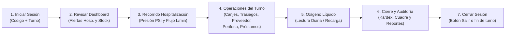

# Manual de Usuario — Sistema de Gestión · Central de Oxígeno (EsSalud – Red Asistencial Cusco)

> **Alcance del documento:** Manual práctico de operación para todo el sistema (autenticación, panel de control, recorrido de hospitalización, operaciones de inventario gaseoso, oxígeno líquido, catálogos, reportes y administración de usuarios).  
> **Dirigido a:** Operadores de almacén, ingenieros de control/reportes y administradores del sistema.  
> **Nivel de detalle:** Alto — redactado estrictamente a partir del código, pantallas, etiquetas, validaciones y mensajes reales del sistema.  
> **Idioma:** Español.

---

## Índice General

1. [Propósito y alcance del sistema](#1-propósito-y-alcance-del-sistema)
2. [Requisitos de acceso, roles y permisos](#2-requisitos-de-acceso-roles-y-permisos)
3. [Mapa general de navegación / módulos](#3-mapa-general-de-navegación--módulos)
4. [Guías paso a paso por flujo o tarea](#4-guías-paso-a-paso-por-flujo-o-tarea)
   - [4.1 Inicio y cierre de sesión](#41-inicio-y-cierre-de-sesión)
   - [4.2 Panel Unificado de Control (Dashboard, Kardex y Stock)](#42-panel-unificado-de-control-dashboard-kardex-y-stock)
   - [4.3 Recorrido Hospitalización (Lecturas, Alertas y Cambio de Cama)](#43-recorrido-hospitalización-lecturas-alertas-y-cambio-de-cama)
   - [4.4 Canje de Balones (Intercambio y Asignación)](#44-canje-de-balones-intercambio-y-asignación)
   - [4.5 Generador de Tickets (Control de Atención)](#45-generador-de-tickets-control-de-atención)
   - [4.6 Trasiego (Llenado Rápido)](#46-trasiego-llenado-rápido)
   - [4.7 Entrada/Salida de Proveedores](#47-entradasalida-de-proveedores)
   - [4.8 Traslado Interno](#48-traslado-interno)
   - [4.9 Canje de Red (Periferia / Centros Médicos)](#49-canje-de-red-periferia--centros-médicos)
   - [4.10 Préstamos a Pacientes y Devoluciones PADOMI](#410-préstamos-a-pacientes-y-devoluciones-padomi)
   - [4.11 Control de Devoluciones (Constancias y Etiquetas)](#411-control-de-devoluciones-constancias-y-etiquetas)
   - [4.12 Oxígeno Líquido: Lectura Diaria de Tanque](#412-oxígeno-líquido-lectura-diaria-de-tanque)
   - [4.13 Oxígeno Líquido: Recarga de Tanque Criogénico (Cisterna)](#413-oxígeno-líquido-recarga-de-tanque-criogénico-cisterna)
   - [4.14 Gestión de Catálogos (Pacientes, Cilindros, Servicios, Camas, Proveedores, Propiedad y Autoridades)](#414-gestión-de-catálogos-pacientes-cilindros-servicios-camas-proveedores-propiedad-y-autoridades)
   - [4.15 Módulo de Reportes y Exportación](#415-módulo-de-reportes-y-exportación)
   - [4.16 Administración de Usuarios](#416-administración-de-usuarios)
5. [Preguntas frecuentes y resolución de problemas (Troubleshooting)](#5-preguntas-frecuentes-y-resolución-de-problemas-troubleshooting)
6. [Glosario de términos y estados](#6-glosario-de-términos-y-estados)
7. [Checklist de Capturas de Pantalla](#7-checklist-de-capturas-de-pantalla)
8. [Dudas para validar](#8-dudas-para-validar)

---

## 1. Propósito y alcance del sistema

El **Sistema de Gestión · Central de Oxígeno (EsSalud – Red Asistencial Cusco)** es una aplicación web diseñada para registrar, controlar y auditar el inventario y consumo diario de **oxígeno medicinal gaseoso (en balones/cilindros)** y **oxígeno líquido (tanque criogénico)** del hospital (HNAGV), pacientes domiciliarios (PADOMI) y centros médicos periféricos (U.P.S. / Red).

### ¿Qué resuelve?
- **Trazabilidad en tiempo real de cilindros:** controla ubicación (`CENTRAL`, `ALMACEN`, `HOSPITALIZACION`, `PADOMI`, `PROVEEDOR`, `PERIFERIE/CENTROS MEDICOS`, `AUTORIDAD / TERCEROS`), estado (`Lleno`, `Vacío`, `En Uso`, `En Tránsito`), propiedad y asignación a pacientes, servicios o camas.
- **Control clínico-operativo en hospitalización:** permite registrar presión (PSI) y flujo (L/min) durante el recorrido, calcular automáticamente las horas de autonomía restantes con cuenta regresiva cada 30 segundos y alertar sobre balones agotados o próximos a agotarse (`≤ 2h`).
- **Control de recetas PADOMI:** valida la vigencia de recetas médicas antes de autorizar canjes, trasiegos o préstamos a pacientes domiciliarios y emite tickets térmicos (`76×76 mm`) y constancias A4.
- **Abastecimiento de oxígeno líquido:** registra lecturas diarias de nivel y contómetro del tanque criogénico, así como recargas por camión cisterna.
- **Consolidación y auditoría:** genera reportes diarios con corte operativo `07:00 AM` (`Reporte Gerencial`, `Resumen Kardex`, `Kardex General`), reportes mensuales, alertas de retención y exportaciones en Excel/impresión.

### ¿A quién está dirigido?
- **Operadores de almacén (`Operator`):** ejecutan el trabajo diario en planta/almacén, recorridos de hospitalización, canjes, trasiegos, abastecimiento y emisión de tickets/reportes.
- **Ingenieros (`Engineer`):** consultan indicadores, reportes gerenciales, kardex, alertas y catálogos (en el sistema actual comparten el mismo alcance de rutas que un operador).
- **Administradores (`Administrator` / `SuperAdmin`):** poseen control operativo total y administran las cuentas, roles y activación/bloqueo del personal.

### Módulos cubiertos por el sistema
1. **Dashboard (Panel Unificado de Control):** KPIs diarios, alerta prioritaria de hospitalización, `Reporte Gerencial`, `Resumen Kardex`, `Kardex General` y `Stock en Almacén`.
2. **Recorrido Hospitalización:** monitoreo de presión, flujo, autonomía, historial y traslados entre camas.
3. **Operaciones:** `Intercambio`, `Control de Atención`, `Trasiego (Cascada)`, `Mov. Proveedor`, `Traslado Interno`, `Periferia/Centros Médicos`, `Préstamos / Terceros` y `Control Devoluciones`.
4. **Oxígeno Líquido:** `Lectura Diaria` y `Recarga Cisterna`.
5. **Catálogos:** `Pacientes` (con sub-gestión de recetas), `Cilindros`, `Servicios`, `Camas`, `Proveedores`, `Tipos de Propiedad` y `Autoridades / Entidades`.
6. **Reportes:** `Búsqueda y Exportación`, `Intercambios PADOMI`, `Alertas de Pacientes`, `Proveedores Ingreso/Salida`, `Periferia Reportes`, `Seguimiento Cilindros`, `Formatos de Control`, `Resumen Mensual` e `Ingresos Mensuales`.
7. **Administración:** `Usuarios` (gestión de cuentas y bloqueo/desbloqueo).

---

## 2. Requisitos de acceso, roles y permisos

### Requisitos de acceso
- Navegador web actualizado (escritorio, tablet o móvil) con acceso a la URL del sistema `[VERIFICAR EN UI/CÓDIGO: URL productiva final asignada al hospital]`.
- Contar con una cuenta **ACTIVA** creada por un Administrador:
  - **Código de Operador** (ej.: `ADMIN01`, `JPEREZ`).
  - **Contraseña** (mínimo 6 caracteres según validación del sistema).
  - **Turno de Trabajo** correspondiente a su guardia (`Mañana`, `Tarde` o `Noche`).
- Para módulos con impresión de etiquetas térmicas (`76×76 mm`) o formatos A4: tener habilitadas las **ventanas emergentes (pop-ups)** en el navegador.

### Cierre de sesión automático por fin de turno
El sistema programa automáticamente un cierre de sesión al llegar a los límites horarios de turno según el reloj del equipo:
- **07:00:00**
- **14:00:00**
- **22:00:00**

Al cumplirse la hora, aparecerá la alerta:
> *"Tu sesión ha finalizado automáticamente por término de turno. Por favor, vuelve a iniciar sesión para continuar."*

Asimismo, si el token de sesión expira o es rechazado por el servidor (HTTP `401`), el sistema limpia la sesión local y redirige automáticamente a `/login`.

### Roles y matriz de permisos

| Rol en el sistema | Etiqueta en creación de usuarios | Dashboard, Recorrido, Operaciones, Líquido, Catálogos y Reportes | Administración → Panel de Usuarios (`/admin/users`) | Notas técnicas verificadas en código |
|---|---|---|---|---|
| `Operator` | `Operador (Almacén)` | ✅ Acceso completo | ❌ Sin acceso (HTTP `403`) | No ve la sección `Administración` en el menú lateral. |
| `Engineer` | `Ingeniero (Reportes)` | ✅ Acceso completo | ❌ Sin acceso (HTTP `403`) | En las rutas del servidor comparte exactamente los mismos permisos que `Operator`. |
| `Administrator` | `Administrador (Total)` | ✅ Acceso completo | ✅ Acceso completo | Único rol que ve el enlace `Administración → Usuarios` en el menú lateral. |
| `SuperAdmin` | `Super Administrador (Sistema)` | ✅ Acceso completo | ⚠️ Acceso por API/URL directa; **oculto en menú lateral** | El servidor permite todas las rutas, pero el menú lateral solo muestra `Usuarios` si el rol es exactamente `Administrator` (ver [Dudas para validar](#8-dudas-para-validar)). |

> **Regla de cuentas inactivas:** Si un administrador bloquea una cuenta (`INACTIVO`), el usuario no podrá iniciar sesión (recibirá `This account is inactive.`) y cualquier solicitud activa devolverá `Inactive account.` (HTTP `403`).

---

## 3. Mapa general de navegación / módulos

Al autenticarse, la interfaz se compone de:
1. **Barra Lateral (Sidebar, izquierda):**
   - Cabecera `Central de Oxígeno`.
   - Buscador `Buscar módulo...` (filtra en tiempo real los ítems del menú y expande automáticamente las secciones coincidentes; si no hay coincidencias muestra `No se encontraron módulos para "..."`).
   - Enlace fijo `Dashboard` (`/`).
   - 5 secciones colapsables (acordeón) cuyo estado abierto/cerrado se recuerda en el navegador y se auto-expande según la ruta activa.
   - Sección `Administración → Usuarios` (visible solo para rol `Administrator`).
   - Tarjeta inferior de perfil con inicial, nombre, rol, `Turno Actual` y botón de **Modo Oscuro/Claro** (sol/luna) para el menú lateral.
   - En pantallas móviles/tablets se abre mediante el botón hamburguesa (`Abrir menú`) y se cierra con la `X`.
2. **Barra Superior (Topbar):**
   - Izquierda: título legible de la pantalla actual y subtítulo `Sistema de Gestión · Central de Oxígeno EsSalud`.
   - Derecha: insignia de turno (`Mañana` verde, `Tarde` azul o `Noche` violeta), avatar + nombre + rol del usuario y botón **`Salir`** (`Cerrar Sesión`).

> 📸 **[INSERTAR CAPTURA: `03_navegacion_sidebar_topbar.png`]** — *Vista completa de la pantalla principal mostrando el Sidebar desplegado a la izquierda (con el buscador `Buscar módulo...`, las secciones en acordeón, la tarjeta de usuario/turno y el botón de tema claro/oscuro) y el Topbar superior con el badge de turno y el botón `Salir` resaltados.*

### Árbol de menú exacto (Sidebar)

| Sección del Sidebar | Opción en el menú | Ruta URL | Título en Topbar |
|---|---|---|---|
| *(Fijo)* | **Dashboard** | `/` | `Dashboard` |
| **Recorrido Hospitalización** | Recorrido Hospitalización | `/reports/hospitalization-control` | `Recorrido Hospitalización` |
| **Operaciones** | Intercambio | `/inventory/exchange` | `Intercambio PADOMI` |
| | Control de Atención | `/reports/ticketcontrol` | `Control de Atención` |
| | Trasiego (Cascada) | `/inventory/decanting` | `Trasiego (Cascada)` |
| | Mov. Proveedor | `/inventory/supplier` | `Movimiento Proveedor` |
| | Traslado Interno | `/inventory/warehouse-transfer` | `Traslado Interno` |
| | Periferia/Centros Médicos | `/inventory/periphery` | `Periferia / Centros Médicos` |
| | Préstamos / Terceros | `/inventory/loan-return` | `Préstamos / Terceros` |
| | Control Devoluciones | `/inventory/return-control` | `Control de Devoluciones` |
| **Oxígeno Líquido** | Lectura Diaria | `/liquid/daily` | `Lectura Diaria de Tanque` |
| | Recarga Cisterna | `/liquid/refill` | `Recarga de Cisterna` |
| **Catálogos** | Pacientes | `/patients` | `Gestión de Pacientes` |
| | Cilindros | `/cylinders` | `Cilindros / Balones` |
| | Servicios | `/services` | `Servicios` |
| | Camas | `/beds` | `Camas` |
| | Proveedores | `/suppliers` | `Proveedores` |
| | Tipos de Propiedad | `/ownership-types` | `Tipos de Propiedad` |
| | Autoridades / Entidades | `/authorities` | `Autoridades / Entidades` |
| **Reportes** | Búsqueda y Exportación | `/reports/unified-search` | `Búsqueda y Exportación` |
| | Intercambios PADOMI | `/reports/padomi-exchanges` | `Sistema de Gestión` |
| | Alertas de Pacientes | `/reports/alerts` | `Alertas de Pacientes` |
| | Proveedores Ingreso/Salida | `/reports/supplier` | `Reporte de Proveedores` |
| | Periferia Reportes | `/reports/periphery` | `Reporte de Periferia` |
| | Seguimiento Cilindros | `/reports/cylinder-tracking` | `Seguimiento de Cilindros` |
| | Formatos de Control | `/reports/control-format` | `Formatos de Control` |
| | Resumen Mensual | `/reports/monthly-resumen` | `Resumen Mensual (Líquido + Gaseoso)` |
| | Ingresos Mensuales | `/reports/monthly-entries` | `Ingresos Mensuales de Cilindros` |
| **Administración** *(solo `Administrator`)* | Usuarios | `/admin/users` | `Gestión de Usuarios` |

> **Nota sobre accesos directos y rutas internas:** Las pestañas del Dashboard también son accesibles por URL directa (`/reports/executive`, `/reports/kardexresume`, `/reports/kardex`). Existen además dos rutas definidas en el enrutador pero **no enlazadas en el Sidebar**: `/reports/consumption` (`Dashboard de Consumo`) y `/admin/reports` (`Reportes Profesionales y Exportación`, ver [Dudas para validar](#8-dudas-para-validar)).

### Flujo típico de trabajo por turno

### Guardado automático de borradores en la nube
Cinco módulos operativos sincronizan un borrador automático en el servidor tras **1 segundo** sin escribir:
- **Canje de Balones** (`Carrito de Canje`)
- **Trasiego** (`Carrito de Trasiego`)
- **Entrada/Salida de Proveedores** (`Carrito de Proveedor`)
- **Traslado Interno** (`Carrito de Traslado Interno`)
- **Canje de Red (Periferia)** (`Carrito de Periferia`)

En la parte superior del formulario verá una barra con el estado del guardado (`Guardando en la nube...`, `Guardado en la nube`, `Borrador sincronizado` o `Error al guardar`) y el botón **`Descartar Borrador`** para limpiar los campos y borrar el borrador guardado.

---

## 4. Guías paso a paso por flujo o tarea

### 4.1 Inicio y cierre de sesión

- **Objetivo:** Autenticarse en el sistema seleccionando el turno de trabajo correspondiente y finalizar la sesión de forma segura.
- **Requisitos previos / Rol necesario:** Cuenta activa (`Operator`, `Engineer`, `Administrator` o `SuperAdmin`).

#### Pasos para iniciar sesión
1. Abra la dirección del sistema en el navegador. Si no tiene sesión activa, será redirigido automáticamente a `/login` (`Central de Oxígeno — Sistema de Gestión · EsSalud`).
2. Ingrese su **`Código de Operador`** (placeholder `Ej: ADMIN01`).
3. Ingrese su **`Contraseña`** (puede alternar la visibilidad con el ícono de ojo a la derecha del campo).
4. En **`Turno de Trabajo`**, seleccione uno de los tres botones:
   - **`Mañana`** (seleccionado por defecto; cambia el fondo a tonos cálidos ámbar).
   - **`Tarde`** (tonos claros neutros).
   - **`Noche`** (fondo oscuro).
5. Haga clic en **`Ingresar al Sistema`** (mientras valida mostrará `Iniciando sesión...`).

> 📸 **[INSERTAR CAPTURA: `01_login_pantalla.png`]** — *Pantalla `/login` mostrando el logotipo `Central de Oxígeno`, los campos `Código de Operador`, `Contraseña`, los 3 botones de `Turno de Trabajo` (`Mañana`, `Tarde`, `Noche`) y el botón azul `Ingresar al Sistema`.*

#### Pasos para cerrar sesión
1. En la esquina superior derecha de la barra superior (Topbar), haga clic en el botón **`Salir`**.
2. El sistema revocará su token en el servidor, limpiará los datos locales y volverá a `/login`.

#### Resultado esperado
- Al iniciar sesión correctamente, el sistema abre el **Dashboard** (`/`) mostrando su nombre, rol y el badge del turno elegido en el Topbar y el Sidebar.

#### Validaciones y mensajes de error frecuentes
- **Campos vacíos:** El navegador bloquea el envío (`Código de Operador` y `Contraseña` son obligatorios).
- **Código o contraseña incorrectos:** Aparece un recuadro rojo con `⚠ Invalid credentials.` (HTTP `401`).
- **Cuenta bloqueada/desactivada:** Aparece `⚠ This account is inactive.` (HTTP `403`). Contacte a un Administrador.
- **Sin conexión con el servidor:** Aparece `⚠ Credenciales incorrectas o error en el servidor.`

> 📸 **[INSERTAR CAPTURA: `02_login_error.png`]** — *Pantalla `/login` con el recuadro rojo de error (`⚠ Invalid credentials.` o `⚠ This account is inactive.`) visible sobre el formulario.*

---

### 4.2 Panel Unificado de Control (Dashboard, Kardex y Stock)

- **Objetivo:** Monitorear el estado diario del almacén (corte operativo `07:00 AM`), detectar alertas críticas de hospitalización, revisar los 3 reportes oficiales integrados y verificar el stock físico en Almacén Central.
- **Requisitos previos / Rol necesario:** Cualquier usuario autenticado.
- **Acceso:** Menú lateral → **`Dashboard`** (`/`).

#### Pasos
1. En la cabecera **`Panel Unificado de Control | Almacén & Kardex`**, verifique la fecha seleccionada (por defecto hoy). Para consultar otro día:
   - Use el selector de fecha, o pulse los accesos rápidos **`Hoy`** / **`Ayer`**.
   - Pulse el botón de actualización circular (**`Actualizar datos del panel`**) para recargar las cifras.
2. Si aparece el **Banner rojo/ámbar `Recambio Prioritario`** (se actualiza automáticamente cada 60 segundos cuando existen balones en hospitalización con flujo > 0 y autonomía `≤ 2h`):
   - Revise los chips `Cama [N] · [Tiempo]` (se muestran hasta 4 + chip `+N más`).
   - Haga clic en cualquier chip o en **`Ver Recorrido`** para ir directamente a `Recorrido Hospitalización`, o cierre temporalmente el aviso con la **`X`** (`Ocultar aviso`).
3. Revise las **4 tarjetas KPI principales**:
   - **`Consumo Gaseoso`:** total en `m³` y cantidad de balones atendidos (pie: `PADOMI` y `HNAGV` en balones de `10m³`).
   - **`Tanque Líquido`:** nivel en `inH2O`, consumo en `m³` y `Autonomía Proyectada` en días.
   - **`Cuadre de Kardex`:** muestra **`Cuadrado`** (verde) si `Saldo Inicial + Ingreso - Consumo = Reserva Física (Turno Noche)`, o **`Descuadre`** (rojo) indicando `Diferencia de [X] m³`.
   - **`Almacén Central`:** cantidad de balones `Llenos`, `Vacíos para recarga` y estado `Stock Activo` (si hay > 0 llenos) o `Bajo Stock` (si es 0).

> 📸 **[INSERTAR CAPTURA: `04_dashboard_principal.png`]** — *Pantalla `Dashboard` mostrando el selector de fecha (`Hoy`/`Ayer`), el banner `Recambio Prioritario` (si existe alerta activa), las 4 tarjetas KPI (`Consumo Gaseoso`, `Tanque Líquido`, `Cuadre de Kardex`, `Almacén Central`) y la barra con las 4 pestañas.*

4. Navegue entre las **4 pestañas internas** según lo que necesite revisar:
   - **Pestaña 1 — `Reporte Gerencial` (`Oficial`):**
     - Muestra el consolidado `REPORTE DE CONSUMO DE OXIGENO` dividido en **`OXIGENO GASEOSO`** (`SALDO INICIAL`, `CONSUMO DE OXIGENO GASEOSO`, `INGRESO DE CILINDROS DE OXIGENO`, `RESERVA DE CILINDROS DE OXIGENO` con `PROYEC. DIAS`, `BALANCE GENERAL`, `RESERVA DE CILINDROS VACIOS DE OXIGENO`) y **`OXIGENO LIQUIDO`** (`SALDO INICIAL`, `CONSUMO`, `INGRESO`, `RESERVA` con `PROYECCION DE CONSUMO (DIAS)`).
     - Pulse **`Descargar Excel`** para obtener `Reporte_Ejecutivo_Consumo_DD-MM-YYYY.xlsx` o **`Imprimir Formato`** para imprimir en A4 horizontal.
   - **Pestaña 2 — `Resumen Kardex` (`Cuadrado` / `Revisión`):**
     - Presenta el `REGISTRO DE CONSUMO DE OXIGENO DIARIO` en cascada por los 3 turnos (**`MAÑANA`**, **`TARDE`**, **`NOCHE`**), con tablas de consumo/ingresos, `RESERVA OXÍGENO GASEOSO (BALONES LLENOS)`, `BALONES VACÍOS OXÍGENO GASEOSO`, firma del responsable y validador final **`CUADRE`** (verde si cuadra, rojo si descuadra).
     - Pulse **`Descargar Excel`** para bajar `Resumen_Kardex_DD-MM-YYYY.xls`.
   - **Pestaña 3 — `Kardex General` (`Matriz Diaria`):**
     - Muestra la matriz `KARDEX ATENCIÓN DE OXÍGENO` por turno con columnas fijas (`N°`, `B. LLENO`, `B. VACIO`, `COD/CAMA`, `NOMBRE/SERVICIO`), 8 categorías de balones (`6M3 ESSALUD`, `6M3 B.PROPIO P`, `8M3 ESSALUD`, `8M3 OXICUSCO`, `10M3 ESSALUD`, `10M3 PRAXAIR`, `10M3 B. PROPIO`, `10M3 PERIFERIE`) divididas en `LLENO`/`VACÍO`, filas agregadas (`OTROS`, `PERIFERIE`, `PLANTA`, `LINDE`), `TOTAL ATENDIDO`, `SALDO FINAL` y `NOMBRE FIRMA`.
     - Pulse **`Descargar Excel`** para bajar `Kardex_Atencion_DD-MM-YYYY.xls`.
   - **Pestaña 4 — `Stock en Almacén`:**
     - Muestra el **`Desglose Exacto en Almacén Central`** agrupado por `PROPIEDAD DE: [Proveedor]`, tabla por `Modelo / Tipo` y subcolumnas `Llenos` y `Vacíos` para cada capacidad (`10 m³`, `8 m³`, `6 m³`).
     - En la parte inferior, use los 4 accesos directos de **`Operaciones Rápidas de Almacén`**: `Canje de Balones`, `Registrar Trasiego`, `Lectura de Tanque` y `Gestión Pacientes`.

> 📸 **[INSERTAR CAPTURA: `05_dashboard_stock_almacen.png`]** — *Pestaña `Stock en Almacén` del Dashboard mostrando las tablas por proveedor (`Llenos` y `Vacíos` por capacidad) y los 4 botones de `Operaciones Rápidas de Almacén` en la parte inferior.*

#### Resultado esperado
- Visualización actualizada del desempeño diario del almacén y descarga/impresión de los formatos oficiales para Dirección Médica y Logística.

#### Validaciones y mensajes de error frecuentes
- Error al cargar el reporte gerencial: `Error al cargar el reporte gerencial.`
- Si `Cuadre de Kardex` aparece en rojo (`Descuadre`), revise los movimientos del día en `Resumen Kardex` o `Búsqueda y Exportación` para detectar ingresos/salidas no registrados o traslados pendientes.

---

### 4.3 Recorrido Hospitalización (Lecturas, Alertas y Cambio de Cama)

- **Objetivo:** Registrar durante la ronda hospitalaria la presión (PSI) y el flujo (L/min) de cada balón asignado a una cama, supervisar la cuenta regresiva de autonomía, consultar historiales y reubicar cilindros entre camas.
- **Requisitos previos / Rol necesario:** Cualquier usuario autenticado. Solo aparecen cilindros ubicados en `HOSPITALIZACION` **que tengan una cama asignada**.
- **Acceso:** Menú lateral → **`Recorrido Hospitalización`** → **`Recorrido Hospitalización`** (`/reports/hospitalization-control`).

#### Flujo A: Consultar estado y filtrar alertas
1. Revise el subtítulo con el turno automático (calculado según la hora local del equipo: `07:00–14:59` Mañana, `15:00–22:59` Tarde, `23:00–06:59` Noche) y el conteo de cilindros.
2. Si hay alertas, revise el banner **`Recambio Prioritario`**:
   - Pulse **`Ver Balones ([N]) ▼`** para desplegar chips clicables (`Cama [N] · [Serie] · [Tiempo]`). Al hacer clic en un chip, la tabla filtra automáticamente ese servicio y cilindro.
   - Pulse **`Filtrar Alertas ([N])`** (o **`Filtrar en Tabla`**) para mostrar únicamente los balones que requieren atención; vuelva a pulsar **`Ver Todos los Balones`** para quitar el filtro.
3. Utilice la barra de filtros según necesite:
   - **`Filtrar por Servicio:`** (por defecto `-- Todos los servicios --`).
   - **`Filtrar por Cama:`** (se habilita únicamente tras seleccionar un servicio).
   - **`Buscar Cilindro / Código:`** (placeholder `Serie o código de barras...`).
4. Interprete la columna **`TIEMPO (RESTANTE)`** según la leyenda de semáforo (la cuenta regresiva se actualiza automáticamente cada 30 segundos):
   - **Negro pulsante (`0h (Agotado)` / `¡Agotado!`):** balón agotado.
   - **Rojo pulsante (`≤ 1h` / `¡Cambio Urgente!`):** alerta crítica.
   - **Ámbar (`1h–2h` / `Cambiar Balón`):** alerta preventiva.
   - **Verde (`> 2h`):** estable (OK).
   - **Gris (`Sin flujo`):** flujo registrado en `0` (balón sin uso activo; no dispara alertas).
   - **`—`:** sin lectura previa registrada.

> 📸 **[INSERTAR CAPTURA: `06_hospitalizacion_recorrido.png`]** — *Pantalla `Recorrido Hospitalización` mostrando el banner `Recambio Prioritario`, la leyenda de semáforo de 4 colores, los filtros `Filtrar por Servicio`, `Filtrar por Cama`, `Buscar Cilindro / Código` y la tabla de cilindros con tiempos restantes.*

#### Flujo B: Registrar una lectura de presión y flujo
1. Ubique la fila del cilindro en la tabla (en escritorio) o su tarjeta (en móvil).
2. Ingrese **`PRESIÓN (PSI)`** (número `≥ 0`) y **`FLUJO (L/min)`** (número `≥ 0`, admite decimales de `0.1`; ingrese **`0`** si el balón no está en uso activo).
3. Mientras edita, la celda `TIEMPO (RESTANTE)` se marcará en azul con la etiqueta **`Sin guardar`** y una estimación preliminar calculada con la fórmula:
   $$\text{Autonomía (h)} = \frac{\text{Volumen de agua (L)} \times (\text{Presión PSI} / 14.5038)}{\text{Flujo (L/min)} \times 60}$$
   *(Volúmenes de agua según capacidad en m³: 2→12 L, 4→23 L, 6→35 L, 8→47 L, 10→58 L, 14→80 L, 40→200 L).*
4. Haga clic en el botón guardar (**ícono de disquete** en escritorio / **`Guardar`** en móvil).

> 📸 **[INSERTAR CAPTURA: `07_hospitalizacion_registro_lectura.png`]** — *Detalle de una fila en `Recorrido Hospitalización` con los campos `PRESIÓN (PSI)` y `FLUJO (L/min)` completados, el indicador azul `Sin guardar` y el botón de disquete resaltado, junto al toast verde `¡Lectura Guardada Exitosamente!`.*

#### Flujo C: Cambiar un cilindro de cama
1. En la fila del cilindro, pulse el botón **`Cambiar de cama`** (ícono de flechas horizontales).
2. En el modal **`Cambiar Cama de Cilindro`**, verifique la tarjeta `Ubicación Actual → Nueva Ubicación`.
3. En **`Cama de Destino: *`**, escriba el número de cama o el nombre del servicio (placeholder `Escribe la cama o servicio (ej: 101, UCI, Medicina)...`). Las camas aparecen agrupadas por servicio mostrando su estado: `Ubicación actual` (deshabilitada), `● En uso` (ámbar) o `○ Libre` (verde).
4. Opcionalmente, escriba el **`Motivo o Notas (opcional):`**.
5. Haga clic en **`Confirmar Traslado`** (mostrará `Reubicando...`).

> 📸 **[INSERTAR CAPTURA: `08_hospitalizacion_cambio_cama.png`]** — *Modal `Cambiar Cama de Cilindro` mostrando la tarjeta `Ubicación Actual → Nueva Ubicación`, el selector desplegado con camas agrupadas por servicio (`○ Libre` / `● En uso`), el campo de notas y el botón `Confirmar Traslado`.*

#### Flujo D: Ver historial del cilindro e imprimir formato de recorrido
- **Ver historial:** Haga clic en el código del cilindro o en el ícono de reloj (**`Ver historial`**). En el modal **`Historial del Cilindro`**, alterne entre las pestañas **`📊 Lecturas de presión ([N])`** (últimas 20 lecturas) y **`🔄 Traslados de cama ([N])`** (últimos 20 traslados).
- **Imprimir hoja de recorrido:** Haga clic en **`Imprimir`** en la barra superior. Se generará un formato horizontal compacto en 1 hoja (`HNAGV ESSALUD CUSCO — FORMATO DE CONTROL DE CILINDROS POR RECORRIDO EN HOSPITALIZACIÓN`) con 2, 3 o 4 columnas según la cantidad de cilindros filtrados.

> 📸 **[INSERTAR CAPTURA: `09_hospitalizacion_historial.png`]** — *Modal `Historial del Cilindro` mostrando la pestaña `📊 Lecturas de presión` con la tabla de fecha/hora, turno, PSI, L/min, horas estimadas, cama y operario.*

#### Resultado esperado
- **Lectura guardada:** Toast verde `¡Lectura Guardada Exitosamente!` indicando la autonomía calculada (o `Sin flujo activo (balón sin uso)` si el flujo es `0`) e inicio inmediato de la cuenta regresiva.
- **Traslado guardado:** Toast verde `¡Cambio de Cama Exitoso!` confirmando nueva cama y servicio; la tabla se actualiza automáticamente.

#### Validaciones y mensajes de error frecuentes
- Falta PSI o Flujo: toast `Lectura Incompleta` — *"Por favor ingresa la presión (PSI) y el flujo (L/min). Puedes poner flujo 0 si el balón no está en uso activo."*
- Traslado sin cama seleccionada: *"Por favor, selecciona la cama de destino."*
- Misma cama que la actual: *"La cama seleccionada es la misma que la cama actual. Selecciona una cama diferente."*
- Impresión sin registros filtrados: toast `Sin datos` — *"No hay cilindros para imprimir."*
- Pop-ups bloqueados al imprimir: *"Por favor habilita las ventanas emergentes en tu navegador para imprimir."*

---

### 4.4 Canje de Balones (Intercambio y Asignación)

- **Objetivo:** Registrar el canje de un balón lleno por uno vacío (`Intercambio`) o la entrega inicial de un balón lleno (`Asignación`) hacia camas de hospitalización, pacientes PADOMI o estaciones de Manifold/Planta.
- **Requisitos previos / Rol necesario:** Cualquier usuario autenticado. El balón a entregar debe estar en estado `Lleno` (`full`). Para pacientes PADOMI, es **obligatorio** que el paciente tenga una **receta activa y vigente**.
- **Acceso:** Menú lateral → **`Operaciones`** → **`Intercambio`** (`/inventory/exchange`).
- **Nota de escáner:** La tecla `Enter` está bloqueada en este formulario para evitar envíos accidentales al usar lectores de códigos de barras. Cuenta con borrador automático en la nube (**`Carrito de Canje`**).

#### Pasos
1. En la sección **`1. Destino y Validación`**, elija una de las 3 pestañas de destino *(cambiar de pestaña limpia los campos actuales)*:
   - **`Área / Hospital`** (por defecto): busque y elija la cama en **`Buscar Cama por Número`** (`-- Buscar o Seleccionar Cama --`). Al seleccionarla, el sistema muestra automáticamente `Servicio asignado: [Nombre]`.
   - **`Paciente`**: busque al paciente en **`Buscar por Código de Canje`** escribiendo al menos 2 caracteres (nombre, apellido o código). El sistema validará la receta automáticamente:
     - **Banner verde:** `Receta vigente hasta el DD/MM/YYYY.` → puede continuar.
     - **Banner rojo:** receta vencida o inexistente → el canje queda bloqueado. Haga clic en **`+ Actualizar Receta`** para abrir el modal **`📋 Recetas de [Paciente]`**, crear/editar una receta con `Fecha Autorización *`, `Fecha Vencimiento *`, `Estado: Activa` y guardar con **`Agregar Receta`** / **`Actualizar Receta`**.
   - **`Manifold / Planta`**: elija el lado del manifold en **`Seleccione el Manifold (Lado)`** (`-- Elegir Manifold Lado A o B --`).
2. En la sección **`2. Movimiento de Balones`**, seleccione el modo de operación:
   - **`🔄 Intercambio`** (por defecto): exige seleccionar **ambos** balones (el lleno entregado y el vacío recibido).
   - **`📤 Asignación`**: solo entrega balón lleno (deshabilita el campo de balón vacío recibido).
3. En **`Cilindro ENTREGADO (Lleno)`**, busque por serie o escanee el código de barras (solo lista balones con estado `full`).
4. Si el modo es **`🔄 Intercambio`**, busque o escanee en **`Cilindro RECIBIDO (Vacío)`** el balón que está recogiendo (solo lista balones en estado `in_use`).
   - *En `Área / Hospital`:* si el balón elegido pertenece a otra cama, aparecerá un aviso amarillo `¡Aviso! Este balón no está registrado en la cama seleccionada...` (y el servidor bloqueará el guardado).
5. Opcionalmente complete **`Notas del Intercambio`** (ej.: estado de precintos, golpes).
6. Haga clic en **`Finalizar Canje`** (`Procesando...`).

> 📸 **[INSERTAR CAPTURA: `10_canje_formulario_destino.png`]** — *Pantalla `Canje de Balones` mostrando la barra `Carrito de Canje` (`Borrador sincronizado` y `Descartar Borrador`), las 3 pestañas de destino, los botones `🔄 Intercambio` / `📤 Asignación`, los selectores `Cilindro ENTREGADO (Lleno)` y `Cilindro RECIBIDO (Vacío)` y el botón `Finalizar Canje`.*

> 📸 **[INSERTAR CAPTURA: `11_canje_paciente_alerta_receta.png`]** — *Pestaña `Paciente` en `Canje de Balones` mostrando la alerta roja de receta vencida (`¡ALERTA! La receta venció el... El intercambio está bloqueado.`) con el botón `+ Actualizar Receta` resaltado.*

#### Resultado esperado
- Se muestra **`¡Intercambio registrado con éxito!`** y se limpia el borrador en la nube.
- El **balón recibido** pasa a estado **`Vacío` (`empty`)**, ubicación **`CENTRAL`**, sin paciente/servicio/cama asignados.
- El **balón entregado** pasa a estado **`En Uso` (`in_use`)**, ubicación **`PADOMI`** (si fue a paciente) o **`HOSPITALIZACION`** (si fue a cama o manifold), con la asignación correspondiente.
- **Solo si el destino fue `Paciente`:** se genera un número correlativo de atención y se abre el modal **`¡Canje Registrado con Éxito!`** con la **`VISTA PREVIA DEL TICKET`** y los botones **`Cerrar`** e **`Imprimir`** (imprime etiqueta térmica `76×76 mm` `CONTROL DE ATENCIÓN N° ...`).

> 📸 **[INSERTAR CAPTURA: `12_canje_confirmacion_ticket.png`]** — *Modal `¡Canje Registrado con Éxito!` mostrando la `VISTA PREVIA DEL TICKET` con `B. LLENO` y `B. VACÍO` y los botones `Cerrar` e `Imprimir`.*

#### Validaciones y mensajes de error frecuentes
- Falta paciente/servicio/cama: `Selecciona un paciente.` / `Selecciona un servicio.` / `Selecciona una cama para el servicio.`
- Receta vencida o inexistente: `No se puede realizar el intercambio con una receta vencida o inexistente.` (y en servidor: `Se requiere una receta activa para realizar un intercambio a un paciente.` / `La receta del paciente ha expirado o es inválida.`).
- Balones faltantes en modo Intercambio: `Para un Intercambio, debes seleccionar ambos balones (el vacío que recibes y el lleno que entregas).`
- Balón faltante en modo Asignación: `Para una Asignación inicial, debes seleccionar el balón lleno a entregar.`
- Balón recibido no coincide con el paciente/servicio/cama (HTTP `422`): `El cilindro a recibir no está asignado actualmente a este paciente.` / `...a este servicio.` / `...a la cama especificada.`

---

### 4.5 Generador de Tickets (Control de Atención)

- **Objetivo:** Consultar el listado cronológico de canjes y devoluciones de pacientes PADOMI, reimprimir etiquetas térmicas (`76×76 mm`) y exportar tickets individuales a Excel.
- **Requisitos previos / Rol necesario:** Cualquier usuario autenticado.
- **Acceso:** Menú lateral → **`Operaciones`** → **`Control de Atención`** (`/reports/ticketcontrol`).

#### Pasos
1. En el panel izquierdo, filtre los registros:
   - Seleccione una **fecha** (por defecto hoy) o pulse **`Por Fecha` / `Ver Todo`** para quitar el filtro de fecha.
   - Elija el tipo en las pestañas: **`Todos`**, **`Intercambios`** o **`Devoluciones`**.
   - Use el buscador `Buscar N° Atención (1, 2, 3...), DNI, Paciente...` (y la `X` para limpiar).
   - Navegue entre páginas (20 registros/página) con **`Anterior`** / **`Siguiente`**.
2. Haga clic en cualquier tarjeta de atención de la lista (`N° ...`, badge `Canje` o `Devolución`).
3. En el panel derecho revise la vista previa del ticket (`CONTROL DE ATENCIÓN N° ...` para canjes, o `DEVOLUCIÓN DE PACIENTE` para devoluciones).
4. Pulse **`Imprimir`** para abrir la etiqueta térmica `76×76 mm`, o pulse **`Excel`** para descargar `Control_Atencion_N[número].xls`.

> 📸 **[INSERTAR CAPTURA: `13_control_atencion_tickets.png`]** — *Pantalla `Generador de Tickets` con el listado filtrado a la izquierda (`Todos`, `Intercambios`, `Devoluciones`, fecha y buscador) y un ticket seleccionado a la derecha con los botones `Imprimir` y `Excel` resaltados.*

#### Resultado esperado
- Generación inmediata del ticket térmico para firma del receptor (`Nombre:` y `Cel:`) o descarga del archivo `.xls`.

#### Validaciones y mensajes de error frecuentes
- Sin coincidencias: `No se encontraron atenciones con los filtros actuales.`
- Sin tarjeta seleccionada: `Selecciona una atención de la lista para ver el ticket.`

---

### 4.6 Trasiego (Llenado Rápido)

- **Objetivo:** Registrar el llenado (recarga por decantación/cascada) de un balón ya asignado a un paciente o servicio, detectando automáticamente su dueño/destino y validando receta vigente cuando corresponde a paciente.
- **Requisitos previos / Rol necesario:** Cualquier usuario autenticado. El balón debe estar en estado `empty` o `in_use` **y asignado a un servicio o paciente** (o ser balón propio de un paciente). Los balones vacíos sin asignar en `CENTRAL` no pueden recibir trasiego.
- **Acceso:** Menú lateral → **`Operaciones`** → **`Trasiego (Cascada)`** (`/inventory/decanting`).
- **Borrador automático:** Sí (`Carrito de Trasiego`, botón `Descartar Borrador`). Bloquea tecla `Enter`.

#### Pasos
1. En **`1. Escanear Balón`**, escanee o escriba la serie en **`Código de Balón`** (`Escanea código de barras o escribe serie...`).
2. Verifique automáticamente la sección **`2. Destino Detectado`**:
   - Mostrará `Pertenece al Servicio: [Nombre]` o `Pertenece al Paciente: [Nombre]`.
   - Si pertenece a un paciente, verificará su receta:
     - **Vigente:** `Receta activa (Expira: DD/MM/YYYY). Dosis: [dosis]`.
     - **Vencida/inexistente:** `El paciente no cuenta con una receta vigente o ha expirado.` — pulse **`+ Renovar Receta`** para actualizarla desde el modal sin salir de la pantalla.
3. Ingrese **`Cantidad a inyectar (m³)`** (número decimal `≥ 0.01`; debajo del campo se indica `Capacidad máxima: [X] m³`).
4. Haga clic en **`Registrar Trasiego`** (`Guardando...`).

> 📸 **[INSERTAR CAPTURA: `14_trasiego_formulario.png`]** — *Pantalla `Trasiego (Llenado Rápido)` con un balón seleccionado en `Código de Balón`, `Cantidad a inyectar (m³)` llena, la tarjeta `2. Destino Detectado` mostrando paciente y receta activa, y el botón `Registrar Trasiego` habilitado.*

#### Resultado esperado
- Mensaje verde **`¡Recarga de balón registrada con éxito!`** y limpieza del borrador.
- Se registra la operación en el historial de trasiegos y el cilindro queda en estado **`En Uso` (`in_use`)** en ubicación `PADOMI` (si paciente) o `HOSPITALIZACION` (si servicio).
- **Advertencia operativa:** Si el balón estaba asociado a una cama específica de hospitalización, el sistema limpia la referencia de cama al guardar el trasiego (ver [Dudas para validar](#8-dudas-para-validar)).

#### Validaciones y mensajes de error frecuentes
- Balón sin asignar: `Este balón no está asignado a ningún paciente ni servicio (estado VACÍO en CENTRAL). Debe estar asignado para poder realizarle un trasiego.`
- Cantidad superior a la capacidad del balón (HTTP `422`): `La cantidad recargada ([X] m³) supera la capacidad máxima del cilindro ([Y] m³).`
- Sin receta válida: `El paciente detectado debe contar con una receta médica vigente.` (botón `Registrar Trasiego` deshabilitado).
- Cantidad faltante o ≤ 0: `Por favor, ingresa una cantidad válida a inyectar.`

---

### 4.7 Entrada/Salida de Proveedores

- **Objetivo:** Registrar en una sola guía de remisión la entrega masiva de balones vacíos al proveedor (salida a recarga) y/o la recepción masiva de balones llenos desde el proveedor.
- **Requisitos previos / Rol necesario:** Cualquier usuario autenticado. Para **Salida** solo se listan balones `VACÍOS` en `CENTRAL` (6–10 m³, no propios de paciente). Para **Entrada** solo se listan balones `EN TRÁNSITO` en `PROVEEDOR` (6–10 m³, no propios de paciente).
- **Acceso:** Menú lateral → **`Operaciones`** → **`Mov. Proveedor`** (`/inventory/supplier`).
- **Borrador automático:** Sí (`Carrito de Proveedor`, botón `Descartar Borrador`). Bloquea tecla `Enter`.

#### Pasos
1. Seleccione la empresa en **`Proveedor`** (`-- Buscar Empresa --`, obligatorio).
2. Escriba el **`Nro Guía de Remisión`** (`Ej: GR-001-12345`, obligatorio; se convierte a mayúsculas).
3. Opcionalmente ingrese **`Notas / Observaciones`** (`Estado del camión, sellos, etc.`).
4. En **`SALIDA (Hacia Proveedor)`** (badge `VACÍOS`): busque o escanee todos los balones vacíos que carga el camión. Verifique el contador **`Total a entregar:`**.
5. En **`ENTRADA (Desde Proveedor)`** (badge `LLENOS`): busque o escanee todos los balones llenos que descarga el proveedor (`[EN PROVEEDOR]`). Verifique el contador **`Total a recibir:`**.
6. Haga clic en **`REGISTRAR MOVIMIENTO COMPLETO`** (`Procesando...`).

> 📸 **[INSERTAR CAPTURA: `15_movimiento_proveedor.png`]** — *Pantalla `Entrada/Salida de Proveedores` con `Proveedor` y `Nro Guía de Remisión` completos, varios balones agregados en `SALIDA (Hacia Proveedor)` y `ENTRADA (Desde Proveedor)`, los contadores visibles y el botón `REGISTRAR MOVIMIENTO COMPLETO`.*

#### Resultado esperado
- Mensaje **`¡Movimiento de proveedor registrado con éxito!`** y limpieza del borrador.
- **Balones de salida:** pasan a estado **`En Tránsito` (`in_transit`)**, ubicación **`PROVEEDOR`**.
- **Balones de entrada:** pasan a estado **`Lleno` (`full`)**, ubicación **`CENTRAL`**.
- La operación queda disponible para imprimir guía A4 en `Reportes → Proveedores Ingreso/Salida`.

#### Validaciones y mensajes de error frecuentes
- Falta proveedor: `Selecciona un proveedor.`
- Falta guía: `Ingresa el número de Guía de Remisión.`
- Ningún balón seleccionado: `Debes seleccionar al menos un balón de entrada o salida.` (backend: `Debe ingresar al menos un cilindro de entrada o de salida.`).

---

### 4.8 Traslado Interno

- **Objetivo:** Mover balones (llenos o vacíos) entre las dos ubicaciones internas del hospital: **`CENTRAL`** y **`ALMACÉN`**.
- **Requisitos previos / Rol necesario:** Cualquier usuario autenticado.
- **Acceso:** Menú lateral → **`Operaciones`** → **`Traslado Interno`** (`/inventory/warehouse-transfer`).
- **Borrador automático:** Sí (`Carrito de Traslado Interno`, botón `Descartar Borrador`). Bloquea tecla `Enter`.

#### Pasos
1. En **`Dirección del Traslado`**, seleccione:
   - **`De CENTRAL hacia ALMACÉN`** (por defecto), o
   - **`De ALMACÉN hacia CENTRAL`** *(cambiar la dirección limpia los balones ya seleccionados)*.
2. Opcionalmente escriba **`Notas / Observaciones`** (`Motivo del traslado interno...`).
3. En **`Balones a Trasladar`** (badge `DESDE CENTRAL` o `DESDE ALMACÉN`), busque o escanee los balones que se moverán. Revise el contador **`Total a mover:`**.
4. Haga clic en **`REGISTRAR TRASLADO`** (`Procesando...`).

> 📸 **[INSERTAR CAPTURA: `16_traslado_interno.png`]** — *Pantalla `Traslado Interno` mostrando el selector `Dirección del Traslado`, varios balones seleccionados en `Balones a Trasladar`, el contador `Total a mover:` y el botón `REGISTRAR TRASLADO`.*

#### Resultado esperado
- Mensaje **`¡Traslado interno registrado con éxito!`** y limpieza del borrador.
- Cada cilindro mantiene su estado actual (`Lleno` o `Vacío`) y cambia únicamente su ubicación a `ALMACEN` o `CENTRAL`.

#### Validaciones y mensajes de error frecuentes
- Sin balones seleccionados: `Debes seleccionar al menos un balón para trasladar.`
- Búsqueda sin coincidencias en origen: `No se encontró el balón en la ubicación de origen.`

---

### 4.9 Canje de Red (Periferia / Centros Médicos)

- **Objetivo:** Registrar el despacho masivo de balones llenos (8–10 m³) hacia hospitales/centros médicos periféricos (U.P.S.) y la recepción de balones que estos devuelven al almacén central.
- **Requisitos previos / Rol necesario:** Cualquier usuario autenticado. El centro médico debe existir en `Catálogos → Servicios` con tipo `PERIFERIE`.
- **Acceso:** Menú lateral → **`Operaciones`** → **`Periferia/Centros Médicos`** (`/inventory/periphery`).
- **Borrador automático:** Sí (`Carrito de Periferia`, botón `Descartar Borrador`). Bloquea tecla `Enter`.

#### Pasos
1. Seleccione el centro médico en **`Hospital de Origen (Red)`** (`-- Buscar Hospital Periférico --`, obligatorio).
2. Opcionalmente ingrese **`Documento / Vale de Salida`** (`Ej: VALE-2024-001`, se convierte a mayúsculas) y **`Notas / Observaciones`**.
3. En **`ENTREGA (Recibimos de Periferia)`** (se habilita tras elegir hospital): busque o escanee (mínimo 2 caracteres) los balones de oxígeno de 8–10 m³ actualmente asignados a ese centro que regresan al almacén. Revise **`Balones ingresados:`**.
4. En **`DESPACHO (Se llevan a su sede)`** (badge `SOLO LLENOS`): busque o escanee (mínimo 2 caracteres) los balones de oxígeno de 8–10 m³ en estado `Lleno` sin servicio asignado que se envían. Revise **`Balones salientes:`**.
5. Haga clic en **`CONFIRMAR CANJE DE RED`** (`Procesando...`).

> 📸 **[INSERTAR CAPTURA: `17_canje_periferia.png`]** — *Pantalla `Canje de Red (Periferia)` con `Hospital de Origen (Red)` seleccionado, balones cargados en `ENTREGA (Recibimos de Periferia)` y `DESPACHO (Se llevan a su sede)`, contadores visibles y botón `CONFIRMAR CANJE DE RED`.*

#### Resultado esperado
- Mensaje **`¡Canje de red registrado con éxito!`** y limpieza del borrador.
- **Balones recibidos (`ENTREGA`):** pasan a estado **`Vacío` (`empty`)** en **`CENTRAL`** (sin servicio asignado). *(Nota: aunque el badge dice `VACÍOS / LLENOS`, el servidor registra todos los entrantes como vacíos).*
- **Balones despachados (`DESPACHO`):** pasan a estado **`En Uso` (`in_use`)**, ubicación **`PERIFERIE/CENTROS MEDICOS`**, asignados al centro seleccionado.
- Queda disponible la guía imprimible en `Reportes → Periferia Reportes`.

#### Validaciones y mensajes de error frecuentes
- Sin hospital: `Selecciona el Hospital Periférico.`
- Sin balones en entrada ni salida: `Debes registrar al menos una entrada o salida.`
- Balón no elegible en despacho: `No se encontró balón o no cumple los requisitos (8-10m³, Lleno).`

---

### 4.10 Préstamos a Pacientes y Devoluciones PADOMI

- **Objetivo:** Entregar en préstamo un balón lleno de `CENTRAL` a un paciente PADOMI que no tiene balón asignado, o registrar la devolución definitiva/temporal de un balón cuando el paciente ya no lo requiere.
- **Requisitos previos / Rol necesario:** Cualquier usuario autenticado.
  - Para **Préstamo:** paciente con receta médica no vencida y balón `LLENO` ubicado en `CENTRAL`.
  - Para **Devolución:** paciente con al menos un balón asignado (no se muestran balones de propiedad `PROPIO`).
- **Acceso:** Menú lateral → **`Operaciones`** → **`Préstamos / Terceros`** (`/inventory/loan-return`).
  > **Importante:** Aunque la opción del menú se llama `Préstamos / Terceros`, la pantalla (`Prestamos a Pacientes`) gestiona exclusivamente **Préstamos y Devoluciones de Pacientes PADOMI** (ver [Dudas para validar](#8-dudas-para-validar)).

#### Flujo A: Pestaña `Prestamo a Paciente`
1. Verifique que está activa la pestaña **`Prestamo a Paciente`** (`Autorizacion para paciente sin balon`).
2. En **`Buscar Paciente PADOMI`**, escriba al menos 2 caracteres (nombre o DNI) y seleccione al paciente.
3. En **`Receta Medica Vigente`**, el sistema verificará las recetas no vencidas:
   - Si existe una sola receta vigente, se selecciona automáticamente; si hay varias, elija una en el desplegable (`Receta #[id] - Vence: [fecha]`).
   - Si no tiene recetas vigentes, aparecerá el bloqueo rojo: `El paciente NO tiene recetas medicas vigentes. No se puede realizar el prestamo.`
4. En **`Detalles del Prestamo`**:
   - Seleccione el **`Balon a Prestar (Solo LLENOS en CENTRAL) *`**.
   - Elija **`Duracion del Prestamo`**: **`Indefinido`** o **`Tiempo Definido`** (si elige `Tiempo Definido`, complete obligatoriamente **`Fecha Esperada de Devolucion *`**).
   - Verifique **`Turno`** (`Mañana`, `Tarde` o `Noche`).
   - Opcionalmente llene **`Notas / Autorizado por`**.
5. Haga clic en **`REGISTRAR PRESTAMO`** (`Registrando...`).

> 📸 **[INSERTAR CAPTURA: `18_prestamo_paciente.png`]** — *Pantalla `Prestamos a Pacientes` en la pestaña `Prestamo a Paciente` mostrando paciente seleccionado, `Receta Medica Vigente`, selector de balón lleno en CENTRAL, opciones `Indefinido`/`Tiempo Definido` y botón `REGISTRAR PRESTAMO`.*

#### Flujo B: Pestaña `Devolucion Paciente`
1. Seleccione la pestaña **`Devolucion Paciente`** (`Paciente ya no necesita el balon`).
2. En **`Buscar Paciente PADOMI`**, busque y seleccione al paciente.
3. En **`Balones asignados a [Nombre]`**, marque la tarjeta del balón que está siendo devuelto.
4. En **`Detalles de la Devolucion`**:
   - Seleccione **`Motivo de Devolucion *`**: `Fallecimiento del paciente`, `Alta médica`, `Viaje / Cambio de domicilio`, `Baja voluntaria` o `Otro motivo`.
   - Verifique **`Turno`**.
   - Seleccione **`Estado en que regresa el balon *`**: **`Vacio`** (`El paciente consumio el oxigeno`, por defecto) o **`Lleno`** (`El balon no fue utilizado`).
   - Opcionalmente agregue **`Notas / Observaciones`** (ej.: nombre del familiar que entrega).
5. Haga clic en **`REGISTRAR DEVOLUCION PADOMI`** (`Registrando...`).
6. En el modal **`¡Devolución Registrada!`** (`Control de Atención N° ...`), pulse **`Etiqueta (76×76)`** y/o **`Constancia A4`** para imprimir el comprobante, y luego **`Cerrar`**.

> 📸 **[INSERTAR CAPTURA: `19_devolucion_paciente_modal.png`]** — *Pestaña `Devolucion Paciente` con el motivo y estado seleccionados, o el modal de confirmación `¡Devolución Registrada!` mostrando el resumen y los botones `Etiqueta (76×76)`, `Constancia A4` y `Cerrar`.*

#### Resultado esperado
- **Préstamo:** Mensaje `✅ Prestamo registrado. El balon ha sido asignado al paciente.` El cilindro pasa a estado **`En Uso` (`in_use`)**, ubicación **`PADOMI`**, asignado al paciente. Si tiene fecha límite vencida sin devolución, generará alerta en `Alertas de Pacientes`.
- **Devolución:** Mensaje `Devolucion registrada. Motivo: [motivo]. El balon regreso a CENTRAL.` Se genera número correlativo de atención, el balón vuelve a **`CENTRAL`** como `Vacío` o `Lleno` (sin paciente asignado), y **todas las recetas activas del paciente pasan automáticamente a estado `Inactiva` (`inactive`)**.

#### Validaciones y mensajes de error frecuentes
- Préstamo sin receta vigente: `El paciente NO tiene recetas medicas vigentes. No se puede realizar el prestamo.` / backend: `El paciente no tiene una receta médica válida y vigente.`
- Balón no lleno o fuera de CENTRAL (HTTP `422`): `El cilindro debe estar lleno y ubicado en CENTRAL para poder ser prestado.`
- Devolución de paciente sin balones: `Este paciente no tiene balones asignados actualmente.`
- Cilindro no pertenece al paciente (HTTP `422`): `El cilindro no está asignado a este paciente. Verifique los datos.`

---

### 4.11 Control de Devoluciones (Constancias y Etiquetas)

- **Objetivo:** Consultar el historial de devoluciones de pacientes PADOMI ya registradas y reimprimir en cualquier momento la etiqueta térmica (`76×76 mm`) o la constancia oficial A4.
- **Requisitos previos / Rol necesario:** Cualquier usuario autenticado.
- **Acceso:** Menú lateral → **`Operaciones`** → **`Control Devoluciones`** (`/inventory/return-control`).

#### Pasos
1. En el panel izquierdo, filtre por fecha (marque/desmarque el checkbox **`Filtrar Fecha`** y elija fecha) y/o busque en `Buscar paciente, DNI, o código...`.
2. Haga clic en un registro de la lista (muestra paciente, hora, código/DNI, motivo y `N°: 00001`).
3. En la tarjeta derecha **`Constancia de Devolución`**, verifique paciente, fecha, motivo y balón devuelto.
4. Haga clic en:
   - **`ETIQUETA (76×76)`** para imprimir la etiqueta adhesiva térmica (`DEVOLUCIÓN DE PACIENTE`), o
   - **`CONSTANCIA A4`** para imprimir el documento oficial `CONSTANCIA DE DEVOLUCIÓN DE CILINDRO DE OXÍGENO` (incluye casillas de motivo definitivo/temporal, tabla del balón, casillas manuales de estado del balón y bloques de firma de `AUTORIZADO` y `PERSONA RESPONSABLE / GARANTE`).

> 📸 **[INSERTAR CAPTURA: `20_control_devoluciones.png`]** — *Pantalla `Control de Devoluciones` con el listado filtrado a la izquierda y la tarjeta `Constancia de Devolución` a la derecha destacando los botones `ETIQUETA (76×76)` y `CONSTANCIA A4`.*

#### Resultado esperado
- Apertura de la vista previa de impresión correspondiente (etiqueta o constancia A4).

#### Validaciones y mensajes de error frecuentes
- Sin registros: `No se encontraron devoluciones para los filtros aplicados.`
- Sin registro seleccionado: `Seleccione una Devolución`.

---

### 4.12 Oxígeno Líquido: Lectura Diaria de Tanque

- **Objetivo:** Registrar el nivel físico del tanque criogénico (`inH2O`) y la lectura acumulada del contómetro (`m³`) por fecha y turno, calcular el consumo y corregir o eliminar lecturas previas.
- **Requisitos previos / Rol necesario:** Cualquier usuario autenticado.
- **Acceso:** Menú lateral → **`Oxígeno Líquido`** → **`Lectura Diaria`** (`/liquid/daily`).

#### Pasos para registrar una lectura
1. En el formulario izquierdo **`Registrar Nueva Lectura`**, verifique o ajuste **`Fecha`** (por defecto hoy) y **`Turno`** (`Mañana`, `Tarde`, `Noche`).
2. Ingrese **`Nivel de Tanque(inH2O)`** (obligatorio, número `≥ 0`, ej. `85.5`).
3. Ingrese **`Lectura Contometro (m³)`** (obligatorio, número `≥ 0`, ej. `125430.2`). Si supera la última lectura registrada, aparecerá el recuadro naranja **`Consumo Estimado: +[X] m³`**.
4. Haga clic en **`Guardar Lectura`** (`Guardando...`).

#### Pasos para corregir o eliminar una lectura
1. En la tabla derecha **`Historial de Lecturas`** (10 registros/página; niveles `< 20 inH2O` se resaltan en rojo), ubique la fila deseada.
2. **Para editar:** haga clic en el ícono de lápiz (`Editar lectura`), modifique fecha, turno, nivel o flujómetro y pulse **`✓ Guardar`** (o la **`X`** para cancelar). El consumo de esa fila se recalcula automáticamente al guardar.
3. **Para eliminar:** haga clic en el ícono de basura (`Eliminar lectura`) y confirme el diálogo `¿Eliminar esta lectura? Esta acción no se puede deshacer.`

> 📸 **[INSERTAR CAPTURA: `21_liquido_lectura_diaria.png`]** — *Pantalla `Lectura Diaria de Tanque` mostrando el formulario `Registrar Nueva Lectura` con el cálculo naranja `Consumo Estimado` a la izquierda, y la tabla `Historial de Lecturas` (con pastillas de nivel y botones de editar/eliminar) a la derecha.*

#### Resultado esperado
- Mensaje verde **`¡Lectura registrada correctamente!`**; la tabla se actualiza con el consumo calculado (`+[X]`) y el nivel alimenta la tarjeta `Tanque Líquido` del Dashboard y el Reporte Gerencial.

#### Validaciones y mensajes de error frecuentes
- Los 4 campos son obligatorios y los valores numéricos deben ser `≥ 0` en el servidor.
- Si la lectura del contómetro es menor o igual a la lectura previa, el sistema guarda consumo `0` (`—`) sin mostrar alerta.
- Al editar/eliminar una lectura antigua, los consumos de lecturas posteriores no se recalculan automáticamente.

---

### 4.13 Oxígeno Líquido: Recarga de Tanque Criogénico (Cisterna)

- **Objetivo:** Registrar el abastecimiento de oxígeno líquido realizado por camión cisterna del proveedor, verificando niveles del tanque, pesos del camión y cantidad facturada en el ticket.
- **Requisitos previos / Rol necesario:** Cualquier usuario autenticado. El proveedor debe existir en el catálogo de Proveedores.
- **Acceso:** Menú lateral → **`Oxígeno Líquido`** → **`Recarga Cisterna`** (`/liquid/refill`).

#### Pasos
1. Seleccione el **`Proveedor / Empresa`** (`-- Selecciona el proveedor --`, obligatorio).
2. Verifique **`Fecha y Hora de Carga`** (precargado con la fecha/hora actual de Perú, obligatorio).
3. En **`Niveles del Tanque`**, ingrese **`Nivel ANTES de la carga`** y **`Nivel DESPUÉS de la carga`** (`% / L`, obligatorios). Si el nivel después es mayor al inicial, se mostrará la caja cyan **`Entrada Calculada (Volumen): +[X]`**.
4. En **`Pesos de la Cisterna`**, ingrese **`Peso ANTES de descargar`** y **`Peso DESPUÉS de descargar`** (`Kg`, obligatorios). Si el peso inicial es mayor al final, aparecerá **`Descarga Calculada (Peso): +[X] Kg`**.
5. En **`Documentación (Ticket)`**:
   - Ingrese **`Guía de Remisión / Ticket N°`** (`Ej: GR-0932`, obligatorio en UI, se convierte a mayúsculas).
   - Verifique **`Cantidad Facturada (Según Ticket)`** (`m³ / L`, obligatorio en UI): el sistema calcula automáticamente `Peso descargado × 0.754` al ingresar los pesos, pero usted puede ajustarlo manualmente para que coincida exactamente con el contómetro/ticket del camión.
6. Haga clic en **`Guardar Recarga`** (`Procesando...`).
7. Verifique el nuevo registro en la tabla inferior **`Historial de Guías y Recargas`**.

> 📸 **[INSERTAR CAPTURA: `22_liquido_recarga_cisterna.png`]** — *Pantalla `Recarga de Tanque Criogénico` con `Niveles del Tanque`, `Pesos de la Cisterna` (mostrando las cajas cyan de volumen y peso descargado), `Documentación (Ticket)`, botón `Guardar Recarga` y tabla inferior `Historial de Guías y Recargas`.*

#### Resultado esperado
- Mensaje **`¡Recarga de cisterna registrada con éxito!`**, limpieza del formulario e incorporación inmediata al historial inferior (que no posee botón de edición ni eliminación en la interfaz).

#### Validaciones y mensajes de error frecuentes
- Todos los campos del formulario son obligatorios en la interfaz y los valores numéricos deben ser `≥ 0` en el servidor.
- Error general: `Error al registrar la recarga. Revisa los datos.`

---

### 4.14 Gestión de Catálogos (Pacientes, Cilindros, Servicios, Camas, Proveedores, Propiedad y Autoridades)

- **Objetivo:** Mantener actualizadas las tablas maestras que alimentan las operaciones diarias.
- **Requisitos previos / Rol necesario:** Cualquier usuario autenticado.

#### A. Catálogo de Pacientes (`Catálogos → Pacientes`, `/patients`)
1. **Buscar y filtrar:** use `Buscar por nombre o DNI...` (también busca por código de canje/trasiego), el selector **`Código:`** (`TODOS`, `CON TRASIEGO`, `CON CANJE`) y **`Receta:`** (`TODAS`, `CON RECETA ACTIVA`, `SIN RECETA ACTIVA`).
2. **Exportar listado:** pulse **`Exportar Excel`** para descargar los pacientes según los filtros actuales.
3. **Crear o editar paciente:** pulse **`Nuevo Paciente`** (o el ícono lápiz `Editar` en la fila):
   - **`Datos Personales`:** `Nombre Completo *` (obligatorio), `DNI` (único si se llena), `Celular`, `Dirección`.
   - **`Receta Inicial` (opcional):** `Dosif. (L/min)`, `Uso (hrs/día)`, `F. Autorización`, `F. Vencimiento`, `Nº Pagaré`. *(Importante: la receta inicial solo se crea/actualiza si ingresa al menos `F. Autorización` o `F. Vencimiento`).*
   - **`Modalidad del Paciente PADOMI`:** active **`🔁 Código Trasiego`** (`P####`) y/o **`🔄 Código Intercambio`** (`####`). Al crear un paciente nuevo, el sistema precarga automáticamente los siguientes códigos correlativos (`AUTO`, desde `P1090` y `3200`).
   - Pulse **`Guardar Paciente`**.
4. **Gestionar historial de recetas:** pulse el ícono de historial (**`Ver/Gestionar Recetas`**) en la fila del paciente. En el modal **`📋 Recetas de [Nombre]`**, puede editar/eliminar recetas existentes o agregar una nueva completando `Dosificación`, `Tiempo Uso`, `Fecha Autorización *` (obligatorio), `Fecha Vencimiento *` (obligatorio), `Nº Pagaré`, `Estado` (`Activa`, `Vencida`, `Inactiva`) y pulsando **`Agregar Receta`** / **`Actualizar Receta`**.
5. **Eliminar paciente:** pulse el ícono tacho (`Eliminar`) y confirme `¿Eliminar este paciente? Se eliminarán también sus recetas.`

> 📸 **[INSERTAR CAPTURA: `23_catalogo_pacientes.png`]** — *Pantalla `Catálogo de Pacientes` mostrando la barra de búsqueda, filtros `Código:` y `Receta:`, botones `Exportar Excel` y `Nuevo Paciente`, y la tabla con badges `TRASIEGO`, `CANJE` e íconos de recetas/editar/eliminar.*

> 📸 **[INSERTAR CAPTURA: `24_catalogo_paciente_modal.png`]** — *Modal `Nuevo Paciente` abierto mostrando las secciones `Datos Personales`, `Receta Inicial` y los toggles `🔁 Código Trasiego` / `🔄 Código Intercambio` con etiqueta `AUTO`.*

#### B. Catálogo de Cilindros (`Catálogos → Cilindros`, `/cylinders`)
- La pantalla **`Inventario & Catálogos`** integra **3 pestañas**: **`Cilindros`**, **`Proveedores`** y **`Tipos de Propiedad`**.
1. **Buscar y filtrar (pestaña `Cilindros`):** buscador `Buscar por código o escanear código de barras...` (Enter busca inmediatamente) y filtros `Ubicación`, `Estado`, `Proveedor`, `Propiedad`, `Servicio / Periferia` y `Cama`. *(Nota: ver incidencia técnica de filtros `Servicio`/`Cama` en [Dudas para validar](#8-dudas-para-validar)).*
2. **Crear o editar cilindro:** pulse **`Nuevo Cilindro`** (o ícono lápiz):
   - Obligatorios: **`Código del Balón *`** (único, mayúsculas), **`Tipo de Gas`** (`OXÍGENO MEDICINAL`, `NITRÓGENO`, `AIRE COMPRIMIDO`, `CO2`), **`Capacidad (m³) *`**, **`Estado`** (`VACÍO`, `LLENO`, `EN USO`, `EN TRÁNSITO`), **`Ubicación`** (`CENTRAL`, `HOSPITALIZACIÓN`, `PADOMI`, `ALMACÉN`, `PROVEEDOR`, `PERIFERIE/CENTROS MEDICOS`), **`Condición Física`** (`BUENA`, `DEFECTUOSA / MALA`), **`Proveedor / Marca`** (obligatorio en servidor) y **`Tipo de Propiedad *`**.
   - Opcionales / condicionales: `Código de Barras (Opcional)` (único si se ingresa), `Fecha P. Hidrostática`, `Asignación Actual` (si ubicación es `HOSPITALIZACION` o `PERIFERIE/CENTROS MEDICOS`), `Paciente Asignado (PADOMI)` (si ubicación es `PADOMI`).
   - **Balón propio:** si el `Tipo de Propiedad` o `Proveedor` contiene `"propio"` o `"paciente"`, aparecerá **`Propietario del Balón`** obligando a elegir radio `Paciente` o `Servicio / Periferia` y su titular.
   - **Creación rápida sin salir del modal:** al final de las listas `Proveedor / Marca` y `Tipo de Propiedad *` existen los botones **`+ Añadir Proveedor`** y **`+ Añadir Tipo de Propiedad`**.
   - Pulse **`Guardar Cilindro`** / **`Actualizar Cilindro`**.
3. **Eliminar cilindro:** pulse el ícono tacho y confirme `¿Eliminar este cilindro?` (el servidor realiza borrado lógico cambiando su estado interno a `lost` y ubicación `DELETED`).

> 📸 **[INSERTAR CAPTURA: `25_catalogo_cilindros.png`]** — *Pantalla `Inventario & Catálogos` mostrando las 3 pestañas (`Cilindros`, `Proveedores`, `Tipos de Propiedad`), los filtros de cilindros y el modal `Nuevo Cilindro` con las opciones de creación rápida `+ Añadir Proveedor` / `+ Añadir Tipo de Propiedad`.*

#### C. Servicios (`Catálogos → Servicios`, `/services`) y Camas (`Catálogos → Camas`, `/beds`)
- **Servicios (`Catálogo de Servicios`):**
  1. Filtre con `Buscar área o servicio...` y el selector `TODOS LOS TIPOS` (`Hospital`, `Manifold`, `Periferia`).
  2. Pulse **`Nuevo Servicio`** (o `Editar`): complete `Nombre del Servicio` (obligatorio, único), `Abreviación (Opcional)` (máx. 20, única) y `Tipo de Área` (`Área Médica (Hospitalización)`, `Área de Recarga (Manifold)` o `Hospital Periférico (Red / Periferia)`). Pulse **`Guardar Servicio`**.
  3. **Restricción al eliminar:** el servidor impide eliminar un servicio si tiene camas (`No se puede eliminar: el servicio tiene [N] cama(s) asociada(s).`) o cilindros (`...tiene [N] cilindro(s) asignado(s).`).
- **Camas (`Catálogo de Camas`):**
  1. Filtre por `Buscar número de cama...` y el selector `TODOS LOS SERVICIOS`.
  2. Pulse **`Nueva Cama`** (o editar): elija `Servicio / Área` (obligatorio), ingrese `Número de Cama` (`Ej: C-185`, mayúsculas, obligatorio) y `Estado` (`Disponible` / `Ocupada`). Pulse **`Guardar Cama`**.

> 📸 **[INSERTAR CAPTURA: `26_catalogo_servicios_camas.png`]** — *Pantalla `Catálogo de Camas` (y/o `Catálogo de Servicios`) con el botón `Nueva Cama`, los badges `DISPONIBLE` / `OCUPADA` y el modal de registro abierto.*

#### D. Proveedores (`/suppliers`), Tipos de Propiedad (`/ownership-types`) y Autoridades / Entidades (`/authorities`)
- **Proveedores (`Catálogo de Proveedores` — también accesible como pestaña en `Cilindros`):**
  - Busque por `Buscar por nombre o RUC...`. Pulse **`Nuevo Proveedor`**: ingrese `Nombre / Razón Social` (obligatorio, único), `RUC` (máx. 11, único), `Teléfono`, `Email`, `Dirección` y pulse **`Guardar`**.
  - Bloqueo al eliminar: el servidor rechaza la eliminación si existen balones asociados (`No se puede eliminar el proveedor porque tiene balones asociados.`).
- **Tipos de Propiedad (`Tipos de Propiedad` — también accesible como pestaña en `Cilindros`):**
  - Vista en tarjetas con contador `Balones registrados`. Pulse **`Nuevo Tipo`**, ingrese `Nombre *` (obligatorio, único) y `Descripción (Opcional)` *(nota: el servidor actualmente no guarda la descripción; ver [Dudas para validar](#8-dudas-para-validar))*.
  - Al pasar el cursor sobre una tarjeta aparecen **`Editar`** y **`Eliminar`** (deshabilitado si tiene balones asociados).
- **Autoridades / Entidades (`Autoridades y Terceros`):**
  - Vista en tarjetas para entidades externas (`MINSA`, `Fiscalización`, etc.). Pulse **`Nueva Entidad`**, ingrese `Nombre de la Entidad *` (obligatorio, único) y `Tipo de Entidad (Opcional)`, y pulse **`Guardar`**.
  - Al pasar el cursor sobre la tarjeta aparecen **`Editar`** y **`Eliminar`** (el servidor bloquea la eliminación si tiene movimientos asociados: `No se puede eliminar la autoridad porque tiene movimientos asociados.`).

> 📸 **[INSERTAR CAPTURA: `27_catalogo_proveedores_propiedad_autoridades.png`]** — *Vistas de tarjetas de `Tipos de Propiedad` y/o `Autoridades y Terceros` mostrando el botón `Nueva Entidad` / `Nuevo Tipo` y las acciones `Editar` / `Eliminar` sobre una tarjeta.*

---

### 4.15 Módulo de Reportes y Exportación

- **Requisitos previos / Rol necesario:** Cualquier usuario autenticado.
- **Acceso:** Menú lateral → **`Reportes`**.

#### A. Búsqueda y Exportación (`Reportes → Búsqueda y Exportación`, `/reports/unified-search`)
Pantalla con **3 pestañas internas**:
1. **`Búsqueda de Movimientos`:**
   - Use los 9 filtros de **`Filtros de Búsqueda Avanzada`**: `Código de Balón`, `Paciente`, `Servicio / Hospitalización`, `Cama` (se habilita al elegir servicio), `Proveedor`, `Doc. Referencia / Código de Canje`, `Turno`, `Fecha Desde` (corte 07:00 AM) y `Fecha Hasta` (hasta 07:00 AM del día siguiente).
   - Pulse **`Buscar`** (o **`Limpiar`** para reiniciar). Revise las 10 columnas de resultados (paginados de 20 en 20).
   - Use **`Imprimir`** o **`Exportar Excel`** (`Reporte_Movimientos_Cilindros_YYYY-MM-DD.xls`). *(Importante: estos dos botones exportan/imprimen únicamente las filas de la página actual visible; para descargar todo un rango use la pestaña 3).*
2. **`Reporte de Trasiegos`:**
   - Filtre por `Paciente`, `Servicio / Área`, `Capacidad del Balón` (`6 m³`, `8 m³`, `10 m³`), `Turno`, `Fecha Inicio` y `Fecha Fin`, y pulse **`Buscar`** (o **`Limpiar`** / **`Actualizar`**).
   - Use **`Imprimir`** o **`Excel`** (`Reporte_Trasiegos_YYYY-MM-DD.xls`, página visible).
3. **`Exportación a Excel`:**
   - Defina **`Fecha Inicio`** y **`Fecha Fin`** en `Parámetros de Exportación`.
   - Opcionalmente configure los **`Filtros para Inventario General`** (`Ubicación`, `Propiedad`, `Proveedor / Modelo`, `Estado`).
   - Elija cualquiera de las **8 tarjetas** (`Proveedor Externo`, `Hospitalización HNAGV`, `Pacientes PADOMI` con selector de modalidad de código, `Centros Asistenciales (Periferia)`, `Trasiegos / Recargas (Cascada)`, `Inventario General (Físico Actual)`, `O2 Líquido: Lecturas`, `O2 Líquido: Recargas`) y haga clic en **`Previsualizar`**.
   - En el modal de previsualización revise la muestra (20 filas/página) y haga clic en **`Confirmar y Descargar Excel ([N])`** para descargar el archivo `.xlsx` completo con todos los registros.

> 📸 **[INSERTAR CAPTURA: `28_reporte_busqueda_exportacion.png`]** — *Pantalla `Búsqueda y Exportación` en la pestaña `Búsqueda de Movimientos` mostrando los `Filtros de Búsqueda Avanzada`, los botones `Limpiar`, `Buscar`, `Imprimir`, `Exportar Excel` y la tabla de resultados.*

> 📸 **[INSERTAR CAPTURA: `29_reporte_exportacion_excel_modal.png`]** — *Pestaña `Exportación a Excel` mostrando las 8 tarjetas de reportes y el modal de previsualización abierto con el botón `Confirmar y Descargar Excel`.*

#### B. Intercambios PADOMI (`/reports/padomi-exchanges`) y Alertas de Pacientes (`/reports/alerts`)
- **`Balones Pacientes PADOMI` (`Reportes → Intercambios PADOMI`):**
  1. Por defecto muestra solo el **último balón en posesión de cada paciente** (`Último Movimiento por Paciente`). Pulse **`Ver Histórico Completo`** para ver todos los movimientos (y **`Solo Último Balón Actual`** para regresar).
  2. Busque por `Buscar por paciente o DNI...` + **`Buscar`**.
  3. Pulse **`Exportar Excel`** para descargar todos los registros sin paginación (`.xlsx`).
- **`Alertas de Pacientes` (`Reportes → Alertas de Pacientes`):**
  1. Evalúa cilindros asignados a pacientes en estado `En Uso` con retención prolongada o préstamos cuya fecha límite ya venció.
  2. Ajuste **`Margen Mínimo:`** (`≥ 1 Mes (Recomendado)`, `≥ 2 Meses` o `≥ 3 Meses`) o busque por nombre, DNI o serie.
  3. Revise las 4 tarjetas KPI clicables (`Total en Alerta`, `Retenido 1 a 2 Meses`, `Retenido ≥ 3 Meses`, `Préstamo Vencido`) y la columna `Motivo Alerta` (`⏳ Préstamo Vencido`, `🚨 Retenido > 3 meses (Crítico)`, `⚠️ Retenido > 2 meses`, `⏱️ Retenido > 1 mes`). En la columna `Contacto / Teléfono`, haga clic en el número para llamar directamente si está en un móvil. Pulse **`Actualizar`** para refrescar.

> 📸 **[INSERTAR CAPTURA: `30_reporte_padomi_y_alertas.png`]** — *Pantalla `Alertas de Pacientes` mostrando las 4 tarjetas KPI, el selector `Margen Mínimo:`, el buscador y la tabla con badges de alerta (`⏳ Préstamo Vencido`, `🚨 Retenido > 3 meses`) y teléfonos de contacto.*

#### C. Reportes de Proveedor (`/reports/supplier`) y Periferia (`/reports/periphery`)
- **`Reportes de Proveedor` (`Reportes → Proveedores Ingreso/Salida`):**
  1. En el panel izquierdo filtre por `Buscar Guía o ID...` y/o `Fecha Desde` – `Fecha Hasta` + botón lupa (`Filtrar por Fechas`).
  2. Seleccione una operación (`Op. #[id]`, `Guía: ...`).
  3. En el panel derecho revise la vista previa (`SALIDA CILINDROS` vacíos vs `INGRESO CILINDROS` llenos) y haga clic en **`Imprimir (A4)`** o **`Exportar Excel`** (`Reporte_Proveedor_[id].xls`).
- **`Reportes de Periferia (U.P.S.)` (`Reportes → Periferia Reportes`):**
  1. En el panel izquierdo filtre por `Buscar U.P.S. o ID...` y/o fechas + botón lupa.
  2. Seleccione una operación (`Op. #[id]`, `U.P.S: ...`).
  3. Pulse **`Imprimir (A4)`** (guía oficial con firmas de almacén y responsable U.P.S.) o **`Exportar Excel`** (`Reporte_Periferia_[id].xls`).

> 📸 **[INSERTAR CAPTURA: `31_reporte_proveedores_periferia.png`]** — *Pantalla `Reportes de Proveedor` (o `Reportes de Periferia (U.P.S.)`) con una operación seleccionada a la izquierda y el formato de guía visible a la derecha junto a los botones `Imprimir (A4)` y `Exportar Excel`.*

#### D. Seguimiento de Cilindros (`Reportes → Seguimiento Cilindros`, `/reports/cylinder-tracking`)
1. En **`Buscar Cilindro por Código o Barra`**, escriba la serie o escanee el código de barras (`Escribe la serie o escanea el código de barras...`).
2. Revise a la izquierda la **`Ficha Técnica`** (`Número de Serie`, `Código de Barras`, `Ubicación Actual`, `Estado Actual`, `Capacidad`, `Propietario / Marca`, paciente/servicio/cama asignados, `Prueba Hidrostática` y `Condición Física`).
3. Revise a la derecha la **`Línea de Tiempo de Operaciones`** cronológica (combina movimientos de inventario y trasiegos con tipo de evento, acción `Ingreso`/`Salida`/`Trasiego`, destino/origen, documento, operario, turno y observaciones).

> 📸 **[INSERTAR CAPTURA: `32_reporte_seguimiento_cilindros.png`]** — *Pantalla `Seguimiento de Balones (Tracking)` con un cilindro seleccionado mostrando la `Ficha Técnica` a la izquierda y la `Línea de Tiempo de Operaciones` a la derecha.*

#### E. Formatos de Control (`/reports/control-format`), Resumen Mensual (`/reports/monthly-resumen`) e Ingresos Mensuales (`/reports/monthly-entries`)
- **`Formatos de Control`:**
  1. Busque en **`Buscar Paciente`** (mínimo 2 caracteres; solo muestra pacientes con **receta activa**).
  2. Verifique la tarjeta `Paciente Seleccionado` y haga clic en **`IMPRIMIR FORMATO A4`** para generar la hoja `CONTROL DE ATENCIÓN PACIENTE` con cuadrícula 5×5 (25 casillas) para llenado manual.
- **`Resumen Mensual de Oxígeno`:**
  1. Seleccione el mes con el selector `<input type="month">` o las flechas **`<`** (`Mes anterior`) / **`>`** (`Mes siguiente`).
  2. Alterne la **`Vista:`** entre **`Ambos`**, **`Oxígeno Líquido`** y **`Consumo Gaseoso`**.
  3. Revise las 4 tarjetas KPI (`Oxígeno Líquido`, `Oxígeno Gaseoso`, `Distribución Red`, `Cobertura Mensual`) y las tablas diarias.
  4. Pulse **`Excel`** para descargar `Resumen_YYYY-MM.xls` *(exporta las tablas visibles según la vista activa)*.
- **`Control de Ingresos de Cilindros` (`Reportes → Ingresos Mensuales`):**
  1. Seleccione el mes con el selector o flechas **`<`** / **`>`**.
  2. Use **`Filtrar filas:`** para alternar entre **`Todos ([N])`** y **`Con Movimiento ([M])`**.
  3. Revise los 4 KPIs (`Ingreso Llenos`, `Salida Vacíos`, `Rechazados / Dañados`, `Días de Despacho`) y la tabla de 17 columnas (`INGRESO LLENO`, `SALIDA VACÍO OM2`, `RECHAZADOS`, totales y observaciones).
  4. Pulse **`Excel`** para descargar `Ingresos_YYYY-MM.xls` *(exporta las filas visibles según el filtro activo)*.

> 📸 **[INSERTAR CAPTURA: `33_reporte_formatos_y_mensuales.png`]** — *Pantalla `Resumen Mensual de Oxígeno` (o `Control de Ingresos de Cilindros`) mostrando el selector de mes, las 4 tarjetas KPI, el botón `Excel` y las tablas diarias.*

---

### 4.16 Administración de Usuarios

- **Objetivo:** Crear nuevas cuentas de personal, editar datos/roles/contraseñas y bloquear o reactivar accesos sin eliminar el historial operativo.
- **Requisitos previos / Rol necesario:** Rol **`Administrator`** (único rol que visualiza el enlace en el menú lateral).
- **Acceso:** Menú lateral → **`Administración`** → **`Usuarios`** (`/admin/users`).

#### Pasos para crear o editar un usuario
1. En **`Panel de Usuarios`**, haga clic en **`Nuevo Operario`** (para crear) o en el ícono de lápiz **`Editar`** en la fila del usuario (para modificar).
2. Complete el modal **`Nuevo Usuario`** / **`Editar Usuario`**:
   - **`Código Operador`** (obligatorio, único, máx. 20 caracteres, convierte a mayúsculas, ej.: `ADMIN01`, `JPEREZ`).
   - **`Rol en el Sistema`** (obligatorio): `Operador (Almacén)` (`Operator`), `Ingeniero (Reportes)` (`Engineer`), `Administrador (Total)` (`Administrator`) o `Super Administrador (Sistema)` (`SuperAdmin`).
   - **`Nombre Completo`** (obligatorio, máx. 100 caracteres).
   - **`Contraseña`**: obligatoria al crear (**mínimo 6 caracteres**); al editar puede dejarla en blanco para conservar la contraseña actual (`Dejar en blanco para no cambiarla`).
3. Haga clic en **`Guardar Usuario`** (`Guardando...`).

#### Pasos para bloquear o reactivar un usuario
1. En la tabla, ubique al usuario y haga clic en el ícono de candado:
   - Candado cerrado (**`Bloquear`**) si está **`ACTIVO`**.
   - Candado abierto (**`Desbloquear`**) si está **`INACTIVO`**.
2. Confirme el cuadro de diálogo (`¿Estás seguro de BLOQUEAR al usuario [Nombre]? Ya no podrá iniciar sesión.` o `¿Estás seguro de REACTIVAR al usuario [Nombre]?`).

> 📸 **[INSERTAR CAPTURA: `34_admin_usuarios.png`]** — *Pantalla `Panel de Usuarios` mostrando la tabla con badges de roles y estados `ACTIVO` / `INACTIVO`, el botón `Nuevo Operario` y el modal `Nuevo Usuario` abierto.*

#### Resultado esperado
- El usuario nuevo queda creado en estado **`ACTIVO`** y puede iniciar sesión de inmediato.
- Al bloquear un usuario, su fila se atenúa con etiqueta roja **`INACTIVO`** y ya no podrá iniciar sesión ni operar el sistema, pero se conserva toda su trazabilidad histórica.

#### Validaciones y mensajes de error frecuentes
- Código de operador repetido o contraseña < 6 caracteres: aparece `alert` con el error devuelto por el servidor.
- Intentar bloquear tu propia cuenta (HTTP `403`): `No puedes desactivar tu propia cuenta.`
- Intentar bloquear al último administrador activo (HTTP `403`): `No puedes desactivar al último Administrador/SuperAdmin activo del sistema.`
- *Nota de interfaz:* La caja `Buscar por código o nombre...` en la parte superior de la tabla actualmente es decorativa y no filtra la lista (ver [Dudas para validar](#8-dudas-para-validar)).

---

## 5. Preguntas frecuentes y resolución de problemas (Troubleshooting)

| Problema / Pregunta | Causa probable | Solución |
|---|---|---|
| **El sistema cerró mi sesión de repente con un aviso de fin de turno.** | Cierre automático programado por el sistema a las **07:00**, **14:00** o **22:00** (o vencimiento del token). | Vuelva a iniciar sesión seleccionando el turno vigente. Si estaba llenando un formulario con borrador automático (`Canje`, `Trasiego`, `Proveedor`, `Traslado` o `Periferia`), sus datos estarán guardados en la nube. |
| **Al iniciar sesión aparece `Invalid credentials.` o `This account is inactive.`** | Código de operador/contraseña mal escritos o cuenta bloqueada (`INACTIVO`). | Verifique mayúsculas/minúsculas de la contraseña y su código. Si la cuenta está inactiva u olvidó la contraseña, solicite a un **Administrador** reactivarla o restablecer la clave desde `Administración → Usuarios`. |
| **No puedo hacer un Canje o Trasiego a un paciente porque aparece banner rojo.** | El paciente no tiene receta registrada, su receta venció o está marcada como `Inactiva` (por ejemplo, tras una devolución previa). | Haga clic en **`+ Actualizar Receta`** (en Canje) o **`+ Renovar Receta`** (en Trasiego), registre una nueva receta con fechas vigentes y estado `Activa`, y reintente la operación. |
| **Un balón no aparece en el buscador de `Canje`, `Trasiego`, `Proveedor` o `Periferia`.** | Cada módulo filtra estrictamente por estado, ubicación, capacidad o asignación previa (ej.: en `Proveedor` solo salen 6–10 m³ no propios; en `Trasiego` el balón debe estar asignado; en `Préstamo` debe estar `Lleno` en `CENTRAL`). | Verifique el estado y ubicación real del balón en `Reportes → Seguimiento Cilindros` o `Catálogos → Cilindros`. Si está mal ubicado internamente, realice un `Traslado Interno`. |
| **Un balón entregado a Hospitalización no aparece en `Recorrido Hospitalización`.** | La pantalla solo muestra cilindros en `HOSPITALIZACION` que tienen una **cama asignada**. Si se entregó a Manifold o se le hizo Trasiego (que limpia la cama), no aparecerá allí. | Verifique la asignación del balón en `Seguimiento Cilindros` y asegúrese de que tenga una cama asignada. |
| **Hice clic en `Imprimir` y no se abrió ninguna ventana.** | El navegador bloqueó las ventanas emergentes (pop-ups). | Habilite los pop-ups para el sitio del sistema en la barra de direcciones del navegador y vuelva a pulsar **`Imprimir`**. |
| **En `Búsqueda de Movimientos` exporté a Excel pero solo bajaron 20 filas.** | El botón `Exportar Excel` de la pestaña `Búsqueda de Movimientos` exporta únicamente la página visible (máx. 20 registros). | Vaya a `Reportes → Búsqueda y Exportación → Exportación a Excel`, seleccione el rango de fechas, pulse **`Previsualizar`** en el reporte correspondiente y luego **`Confirmar y Descargar Excel`**. |
| **El `Cuadre de Kardex` en el Dashboard aparece en rojo (`Descuadre`).** | La fórmula `Saldo Inicial + Ingresos - Consumo` no coincide con la reserva física del turno Noche (corte 07:00 AM). | Revise las tablas por turno en `Dashboard → Resumen Kardex` y verifique si faltó registrar un ingreso de proveedor, un traslado entre `ALMACEN` y `CENTRAL`, o una devolución. |
| **No puedo eliminar un Servicio, Proveedor, Tipo de Propiedad o Autoridad.** | Existen registros asociados (camas, balones o movimientos históricos) y el servidor protege la integridad referencial. | Reasigne o libere primero los registros dependientes antes de intentar eliminar el catálogo. |
| **¿Se puede editar o anular un movimiento de cilindros ya guardado?** | Los movimientos de inventario de cilindros no tienen botón de edición ni eliminación en la interfaz para preservar la trazabilidad del Kardex. | Registre la operación compensatoria correspondiente (por ejemplo, una devolución o traslado interno) y anote el motivo en `Notas / Observaciones`. *(Excepción: las lecturas diarias de tanque líquido sí permiten edición y eliminación).* |

---

## 6. Glosario de términos y estados

### Estados de cilindros (`status`)
| Etiqueta en UI | Valor interno | Significado |
|---|---|---|
| **Lleno** | `full` | Cilindro cargado y disponible para entrega, préstamo o despacho. |
| **Vacío** | `empty` | Cilindro sin gas (generalmente en `CENTRAL` o `ALMACEN`) a la espera de recarga con proveedor o trasiego. |
| **En Uso** | `in_use` | Cilindro actualmente entregado/asignado a un paciente PADOMI, cama de hospitalización, manifold, periferia o tercero. |
| **En Tránsito** | `in_transit` | Cilindro vacío entregado al camión del proveedor externo para recarga (en espera de retorno lleno). |
| **Extraviado** *(solo Tracking / borrado lógico)* | `lost` | Estado asignado internamente cuando un cilindro es eliminado desde el catálogo. |

### Ubicaciones de cilindros (`location`)
| Ubicación | Significado |
|---|---|
| **`CENTRAL`** | Central de Oxígeno (punto principal de despacho y recepción diaria). |
| **`ALMACEN`** | Almacén interno de reserva/planta. |
| **`HOSPITALIZACION`** | Áreas médicas internas del hospital (camas y estaciones de manifold). |
| **`PADOMI`** | En domicilio de un paciente del Programa de Atención Domiciliaria. |
| **`PROVEEDOR`** | En poder de la empresa proveedora externa para recarga. |
| **`PERIFERIE/CENTROS MEDICOS`** | En poder de un hospital o centro asistencial periférico de la red (U.P.S.). |
| **`AUTORIDAD / TERCEROS`** | En poder de una entidad externa/autoridad *(usado por el endpoint de préstamos a terceros)*. |

### Estados de recetas médicas (`status`)
| Etiqueta en UI | Valor interno | Significado |
|---|---|---|
| **Activa** | `active` | Receta habilitada; si su fecha de vencimiento es hoy o posterior, autoriza canjes y trasiegos. |
| **Vencida** | `expired` | Receta expirada; bloquea operaciones de canje y trasiego hasta ser renovada. |
| **Inactiva** | `inactive` | Receta suspendida (también se asigna automáticamente a las recetas activas de un paciente al registrar una devolución PADOMI). |

### Niveles de alerta en `Recorrido Hospitalización`
| Etiqueta / Color | Condición |
|---|---|
| **⛔ `0h (Agotado)` / `¡Agotado!`** (Negro pulsante) | Cuenta regresiva en `0h` (autonomía agotada). |
| **🚨 `≤ 1h` / `¡Cambio Urgente!`** (Rojo pulsante) | Autonomía restante mayor a `0h` y menor o igual a `1 hora`. |
| **⚠️ `1h–2h` / `Cambiar Balón`** (Ámbar) | Autonomía restante mayor a `1 hora` y menor o igual a `2 horas`. |
| **🟢 `> 2h`** (Verde) | Autonomía estable mayor a `2 horas`. |
| **⚪ `Sin flujo`** (Gris) | Flujo registrado en `0 L/min` (balón en cama pero sin consumo activo; no genera alertas). |

### Estados de camas (`status`)
- **`DISPONIBLE` (`available`):** Cama marcada como libre en el catálogo.
- **`OCUPADA` (`occupied`):** Cama marcada como ocupada en el catálogo.

### Conceptos operativos clave
- **Corte operativo (`07:00 AM`):** Día logístico usado por los reportes gaseosos (`07:00 AM` del día seleccionado hasta `07:00 AM` del día siguiente).
- **Turnos (`shift`):** `Morning` (`Mañana`), `Afternoon` (`Tarde`), `Night` (`Noche`).
- **Trasiego (Cascada / Decanting):** Llenado de un balón pequeño desde balones matriz en la estación de trasiego.
- **PADOMI:** Programa de Atención Domiciliaria de EsSalud.
- **U.P.S. / Periferia:** Unidades Productoras de Servicios / centros asistenciales periféricos de la Red Asistencial Cusco.
- **Manifold:** Colector/estación de distribución de oxígeno por red en planta.
- **Control de Atención (`attention_number`):** Número correlativo único generado automáticamente para canjes y devoluciones de pacientes PADOMI.

---

## 7. Checklist de Capturas de Pantalla

Use esta lista ordenada para tomar e insertar todas las capturas referenciadas en el manual:

1. [ ] `01_login_pantalla.png` — Pantalla `/login` con campos `Código de Operador`, `Contraseña`, los 3 botones de `Turno de Trabajo` y el botón `Ingresar al Sistema`.
2. [ ] `02_login_error.png` — Pantalla `/login` mostrando el banner rojo de error de acceso (`Invalid credentials.` o `This account is inactive.`).
3. [ ] `03_navegacion_sidebar_topbar.png` — Vista general con Sidebar expandido (`Buscar módulo...`, acordeones, tarjeta de usuario/turno, botón claro/oscuro) y Topbar (`badge de turno`, `Salir`).
4. [ ] `04_dashboard_principal.png` — Dashboard (`/`) con selector de fecha (`Hoy`/`Ayer`), banner `Recambio Prioritario`, 4 tarjetas KPI y las 4 pestañas.
5. [ ] `05_dashboard_stock_almacen.png` — Pestaña `Stock en Almacén` del Dashboard con las tablas por proveedor/capacidad y los 4 botones de `Operaciones Rápidas de Almacén`.
6. [ ] `06_hospitalizacion_recorrido.png` — `Recorrido Hospitalización` (`/reports/hospitalization-control`) con banner de alertas, leyenda de semáforo, filtros y tabla principal.
7. [ ] `07_hospitalizacion_registro_lectura.png` — Edición de `PRESIÓN (PSI)` y `FLUJO (L/min)` en `Recorrido Hospitalización` con etiqueta `Sin guardar`, botón guardar y toast verde de éxito.
8. [ ] `08_hospitalizacion_cambio_cama.png` — Modal `Cambiar Cama de Cilindro` con selector de camas agrupado por servicio (`○ Libre` / `● En uso`) y botón `Confirmar Traslado`.
9. [ ] `09_hospitalizacion_historial.png` — Modal `Historial del Cilindro` mostrando la pestaña `📊 Lecturas de presión`.
10. [ ] `10_canje_formulario_destino.png` — `Canje de Balones` (`/inventory/exchange`) con barra `Carrito de Canje`, 3 pestañas de destino, selector `Intercambio`/`Asignación` y campos de balones.
11. [ ] `11_canje_paciente_alerta_receta.png` — Pestaña `Paciente` en `Canje de Balones` con alerta roja de receta vencida y botón `+ Actualizar Receta`.
12. [ ] `12_canje_confirmacion_ticket.png` — Modal `¡Canje Registrado con Éxito!` con `VISTA PREVIA DEL TICKET` y botones `Cerrar` e `Imprimir`.
13. [ ] `13_control_atencion_tickets.png` — `Generador de Tickets` (`/reports/ticketcontrol`) con lista filtrable izquierda y ticket seleccionado a la derecha con `Imprimir` y `Excel`.
14. [ ] `14_trasiego_formulario.png` — `Trasiego (Llenado Rápido)` (`/inventory/decanting`) con balón escaneado, cantidad, tarjeta `2. Destino Detectado` (receta activa) y botón `Registrar Trasiego`.
15. [ ] `15_movimiento_proveedor.png` — `Entrada/Salida de Proveedores` (`/inventory/supplier`) con guía, balones en `SALIDA` y `ENTRADA`, contadores y `REGISTRAR MOVIMIENTO COMPLETO`.
16. [ ] `16_traslado_interno.png` — `Traslado Interno` (`/inventory/warehouse-transfer`) con `Dirección del Traslado`, balones seleccionados, contador `Total a mover:` y botón `REGISTRAR TRASLADO`.
17. [ ] `17_canje_periferia.png` — `Canje de Red (Periferia)` (`/inventory/periphery`) con hospital elegido, paneles `ENTREGA` y `DESPACHO` y botón `CONFIRMAR CANJE DE RED`.
18. [ ] `18_prestamo_paciente.png` — `Prestamos a Pacientes` (`/inventory/loan-return`), pestaña `Prestamo a Paciente` completa con receta vigente, balón en CENTRAL y botón `REGISTRAR PRESTAMO`.
19. [ ] `19_devolucion_paciente_modal.png` — Pestaña `Devolucion Paciente` y/o modal `¡Devolución Registrada!` con botones `Etiqueta (76×76)` y `Constancia A4`.
20. [ ] `20_control_devoluciones.png` — `Control de Devoluciones` (`/inventory/return-control`) con listado izquierdo y tarjeta `Constancia de Devolución` derecha (`ETIQUETA (76×76)`, `CONSTANCIA A4`).
21. [ ] `21_liquido_lectura_diaria.png` — `Lectura Diaria de Tanque` (`/liquid/daily`) con formulario izquierdo (bloque `Consumo Estimado`) y tabla `Historial de Lecturas` derecha.
22. [ ] `22_liquido_recarga_cisterna.png` — `Recarga de Tanque Criogénico` (`/liquid/refill`) con niveles, pesos (cajas cyan de cálculo), documentación y tabla `Historial de Guías y Recargas`.
23. [ ] `23_catalogo_pacientes.png` — `Catálogo de Pacientes` (`/patients`) con filtros `Código:`/`Receta:`, tabla con badges `TRASIEGO`/`CANJE`, botón `Exportar Excel` y `Nuevo Paciente`.
24. [ ] `24_catalogo_paciente_modal.png` — Modal `Nuevo Paciente` mostrando `Datos Personales`, `Receta Inicial` y toggles de modalidad PADOMI (`AUTO`).
25. [ ] `25_catalogo_cilindros.png` — `Inventario & Catálogos` (`/cylinders`) con las 3 pestañas y el modal `Nuevo Cilindro` mostrando creación rápida de proveedor/propiedad.
26. [ ] `26_catalogo_servicios_camas.png` — `Catálogo de Camas` (`/beds`) y/o `Catálogo de Servicios` (`/services`) con el modal de creación abierto.
27. [ ] `27_catalogo_proveedores_propiedad_autoridades.png` — Vistas de `Tipos de Propiedad` (`/ownership-types`) y/o `Autoridades y Terceros` (`/authorities`) mostrando tarjetas y botones `Editar`/`Eliminar`.
28. [ ] `28_reporte_busqueda_exportacion.png` — `Búsqueda y Exportación` (`/reports/unified-search`), pestaña `Búsqueda de Movimientos` con filtros avanzados y tabla de resultados.
29. [ ] `29_reporte_exportacion_excel_modal.png` — Pestaña `Exportación a Excel` con las 8 tarjetas y el modal de previsualización abierto (`Confirmar y Descargar Excel`).
30. [ ] `30_reporte_padomi_y_alertas.png` — `Alertas de Pacientes` (`/reports/alerts`) con las 4 tarjetas KPI, selector `Margen Mínimo:` y tabla con motivos de alerta.
31. [ ] `31_reporte_proveedores_periferia.png` — `Reportes de Proveedor` (`/reports/supplier`) o `Reportes de Periferia (U.P.S.)` (`/reports/periphery`) con vista previa de guía y botones `Imprimir (A4)` / `Exportar Excel`.
32. [ ] `32_reporte_seguimiento_cilindros.png` — `Seguimiento de Balones (Tracking)` (`/reports/cylinder-tracking`) con `Ficha Técnica` y `Línea de Tiempo de Operaciones`.
33. [ ] `33_reporte_formatos_y_mensuales.png` — `Resumen Mensual de Oxígeno` (`/reports/monthly-resumen`) o `Control de Ingresos de Cilindros` (`/reports/monthly-entries`) con KPIs, selector de mes y botón `Excel`.
34. [ ] `34_admin_usuarios.png` — `Panel de Usuarios` (`/admin/users`) con tabla `ACTIVO`/`INACTIVO`, botón `Nuevo Operario` y modal `Nuevo Usuario`.

---

## 8. Dudas para validar

Durante la auditoría del código fuente se detectaron las siguientes inconsistencias o comportamientos críticos que conviene validar con el equipo técnico/funcional antes de publicar la versión definitiva del manual:

1. **Menú `Préstamos / Terceros` vs. funcionalidad real (`/inventory/loan-return`):** El menú se llama `Préstamos / Terceros` y el backend incluye `POST /inventory/loan-return` para préstamos a **Autoridades/Entidades**, pero la pantalla actual solo atiende **Préstamos y Devoluciones a Pacientes PADOMI** (`patient-loan` / `patient-return`). Ninguna pantalla del frontend consume el endpoint de préstamos a autoridades.
2. **Rol `SuperAdmin` oculto en el Sidebar:** El backend (`CheckRole.php`) otorga acceso total a `SuperAdmin`, pero `Sidebar.jsx` solo muestra `Administración → Usuarios` cuando `user?.role === 'Administrator'`. Confirmar si `SuperAdmin` también debe ver dicho menú.
3. **Diferencia funcional entre `Operator` y `Engineer`:** Aunque en la pantalla de Usuarios se describe como `Ingeniero (Reportes)`, en `routes/api.php` el rol `Engineer` tiene exactamente los mismos permisos de escritura y operación que `Operator`. Confirmar si debe ser solo lectura o mantener acceso operativo completo.
4. **Traslado Interno siempre guarda turno `Morning`:** `WarehouseTransfer.jsx` muestra el turno actual en pantalla pero no envía el campo `shift` al backend, por lo que todos los traslados internos quedan registrados como `Morning`.
5. **Recorrido Hospitalización ignora el turno de sesión:** Calcula el turno con la hora local del equipo (`07:00–14:59` Mañana, `15:00–22:59` Tarde, `23:00–06:59` Noche) en lugar del turno seleccionado al iniciar sesión (y difiere también de los cortes de auto-logout `07:00 / 14:00 / 22:00`).
6. **Trasiego limpia la cama asignada (`current_bed_id = null`):** Si se realiza un trasiego sobre un balón asignado a una cama de hospitalización, el backend borra su `current_bed_id` y el balón deja de aparecer en `Recorrido Hospitalización`.
7. **Préstamo a paciente acepta recetas `inactive` si la fecha no venció:** Aunque registrar una `Devolución PADOMI` marca como `inactive` las recetas activas del paciente, `Préstamo a Paciente` solo valida `expires_at >= hoy` sin verificar `status === 'active'`.
8. **Filtros y buscadores no operativos o parciales:**
   - En `Panel de Usuarios` (`/admin/users`), el campo `Buscar por código o nombre...` no tiene evento conectado y no filtra la tabla.
   - En `Catálogo de Cilindros` (`/cylinders`), los filtros `Servicio / Periferia` y `Cama` envían parámetros que el backend no procesa.
   - En `Autoridades / Entidades` (`/authorities`), el backend pagina de 15 en 15, pero la pantalla no tiene paginación ni buscador (si hay > 15 entidades, las demás no se ven).
   - En `Tipos de Propiedad` (`/ownership-types`), el campo `Descripción` aparece en la UI pero el backend no lo valida ni guarda en base de datos.
   - En `Alertas de Pacientes` (`/reports/alerts`), la tarjeta `Retenido 1 a 2 Meses` cuenta de 30 a 89 días, pero su filtro al hacer clic solo muestra de 30 a 59 días (ocultando los de 60 a 89 días).
9. **Inconsistencias menores en impresiones y exportaciones:**
   - `Formatos de Control` lee `patient.phone` en lugar de `phone1`, pudiendo imprimir el celular en blanco.
   - `Balones Pacientes PADOMI` lee `phone_number` en lugar de `phone1`/`phone2`.
   - En `Reportes de Proveedor`, la vista previa en pantalla y Excel imprime fijo `Total Linde Perú` sin importar el proveedor seleccionado.
   - En `Exportación a Excel` (`excelExportService.js`), varios reportes imprimen un nombre fijo en el encabezado (`RESPONSABLE: WILY CHUQUIPIUNTA SAAVEDRA`) y las exportaciones de `O2 Líquido` presentan filas de cabecera sin texto en fila 5.
   - En `Kardex General`, el saldo inicial cuenta solo `CENTRAL` (sin `ALMACEN`), a diferencia de `Resumen Kardex` y `Reporte Gerencial` que suman ambos.
   - En `Catálogo de Servicios`, la alerta de eliminación dice *"También se eliminarán las camas asociadas"*, pero el servidor en realidad bloquea la eliminación si existen camas o cilindros asociados.
   - En `Modal de Recetas` (dentro de `Canje` y `Trasiego`), el botón de eliminar receta carece de texto/ícono visible en pantallas de escritorio (`>= sm`).
   - Existen dos rutas en `App.jsx` sin enlace en el Sidebar: `/reports/consumption` (`Dashboard de Consumo`) y `/admin/reports` (`Reportes Profesionales y Exportación`, que además presenta un error de referencia al usar `format` sin importarlo).
