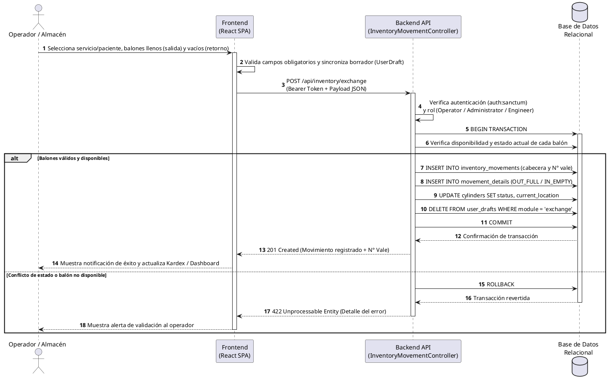
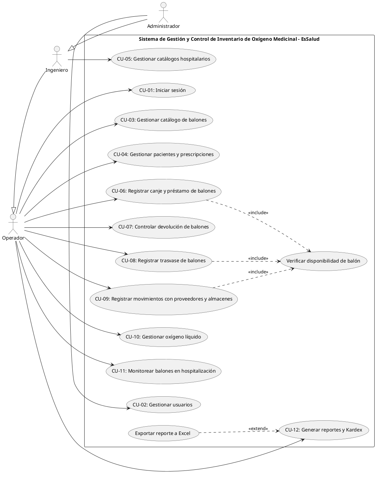
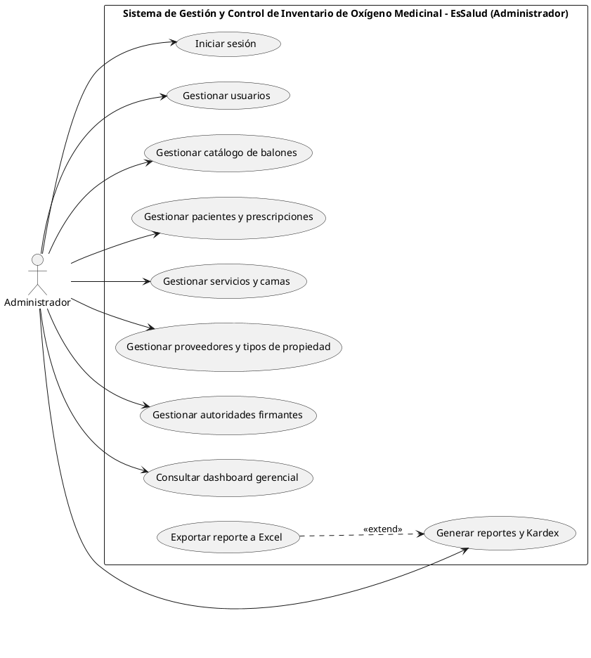
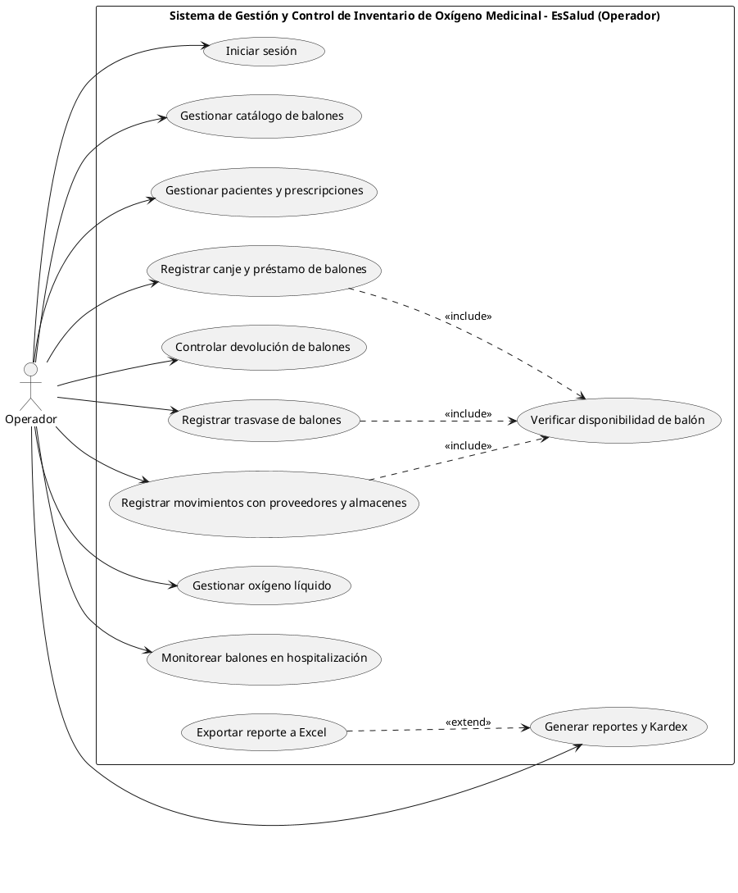

## 3.2. Planificación del Proyecto

La planificación del proyecto para el **Sistema de Gestión y Control de Inventario de Oxígeno Medicinal (EsSalud)** establece el marco técnico, funcional y temporal para el desarrollo de una solución integral orientada a la trazabilidad de balones de oxígeno gaseoso, monitoreo de tanques criogénicos de oxígeno líquido, control de préstamos/canjes (Hospitalización, PADOMI, Periferia y Proveedores) y generación de reportes auditable-gerenciales (Kardex, Formato de Control y Consumo Mensual).

---

### 3.2.1. Análisis de Requisitos

El levantamiento de requisitos se estructuró a partir de las necesidades operativas del área de Ingeniería Hospitalaria, Almacén de Gases Medicinales y Servicios Asistenciales de EsSalud.

#### A. Requisitos Funcionales (RF)

**Tabla 1**  
*RF1. Autenticación y Control de Sesiones*

| Campo | Detalle |
| :--- | :--- |
| **Número de Requisito** | RF-01 |
| **Nombre de Requisito** | Autenticación y Control de Sesiones |
| **Tipo** | ☑ Requisito ☐ Restricción |
| **Fuente del Requisito** | Administrador del Sistema / Operador / Ingeniero |
| **Prioridad del requisito** | ☑ Alta/Esencial ☐ Media/Deseado ☐ Baja/Opcional |
| **Descripción** | RF1.1: Mostrar un formulario de inicio de sesión solicitando correo electrónico o usuario y contraseña.  RF1.2: Validar las credenciales contra la base de datos y verificar que la cuenta del usuario se encuentre activa (`is_active = true`).  RF1.3: Generar un token de acceso seguro (`Bearer Token` mediante Laravel Sanctum) al autenticarse exitosamente.  RF1.4: Identificar y cargar el rol del usuario (`Administrator`, `Engineer`, `Operator`) para habilitar los módulos correspondientes en el menú lateral.  RF1.5: Permitir el cierre de sesión revocando el token activo en el servidor y limpiando el estado de sesión en el navegador. |

 

**Tabla 2**  
*RF2. Gestión de Usuarios y Roles*

| Campo | Detalle |
| :--- | :--- |
| **Número de Requisito** | RF-02 |
| **Nombre de Requisito** | Gestión de Usuarios y Roles |
| **Tipo** | ☑ Requisito ☐ Restricción |
| **Fuente del Requisito** | Administrador del Sistema |
| **Prioridad del requisito** | ☑ Alta/Esencial ☐ Media/Deseado ☐ Baja/Opcional |
| **Descripción** | RF2.1: Permitir únicamente a los usuarios con rol `Administrator` acceder al módulo de administración de cuentas de usuario.  RF2.2: Registrar nuevos usuarios ingresando nombre completo, correo electrónico, contraseña encriptada y asignación de rol (`Operator`, `Engineer`, `Administrator`).  RF2.3: Permitir la edición de datos de perfil, actualización de credenciales y cambio de rol.  RF2.4: Permitir activar o desactivar cuentas de usuario (`toggle-status`) sin eliminar su historial de movimientos registrados en el Kardex. |

 

**Tabla 3**  
*RF3. Gestión del Catálogo de Balones de Oxígeno*

| Campo | Detalle |
| :--- | :--- |
| **Número de Requisito** | RF-03 |
| **Nombre de Requisito** | Gestión del Catálogo de Balones de Oxígeno |
| **Tipo** | ☑ Requisito ☐ Restricción |
| **Fuente del Requisito** | Operador de Planta / Ingeniero Hospitalario |
| **Prioridad del requisito** | ☑ Alta/Esencial ☐ Media/Deseado ☐ Baja/Opcional |
| **Descripción** | RF3.1: Permitir el registro individual de cilindros/balones de oxígeno indicando código de serie o código patrimonial único.  RF3.2: Registrar la capacidad volumétrica del balón en metros cúbicos ($\text{m}^3$), tales como $10\text{ m}^3$, $8\text{ m}^3$, $6\text{ m}^3$, $2\text{ m}^3$ o portátiles.  RF3.3: Asignar el tipo de propiedad del balón (Propio EsSalud, Proveedor Externo, Préstamo u otros registrados en el catálogo de propiedades).  RF3.4: Gestionar el estado operativo actual del balón (`Lleno`, `Vacío`, `Mantenimiento`, `Baja`) y su ubicación física actual (Almacén, Servicio Hospitalario, Paciente PADOMI, Periferia o Proveedor).  RF3.5: Permitir el filtrado y búsqueda rápida por código de balón, capacidad, propietario, ubicación y estado. |

 

**Tabla 4**  
*RF4. Gestión de Pacientes y Prescripciones Médicas*

| Campo | Detalle |
| :--- | :--- |
| **Número de Requisito** | RF-04 |
| **Nombre de Requisito** | Gestión de Pacientes y Prescripciones Médicas |
| **Tipo** | ☑ Requisito ☐ Restricción |
| **Fuente del Requisito** | Operador de Oxígeno / Área Asistencial y PADOMI |
| **Prioridad del requisito** | ☑ Alta/Esencial ☐ Media/Deseado ☐ Baja/Opcional |
| **Descripción** | RF4.1: Registrar pacientes beneficiarios de oxigenoterapia consignando tipo y número de documento (DNI/CE), nombres completos, teléfono, dirección y modalidad de atención (`PADOMI`, `Hospitalizado`, `Ambulatorio`).  RF4.2: Generar automáticamente códigos correlativos de control para nuevos registros de pacientes (`next-codes`).  RF4.3: Permitir el registro y administración de recetas o prescripciones médicas asociadas al paciente.  RF4.4: Especificar en cada prescripción el flujo de oxígeno indicado ($\text{L/min}$), horas de uso diario, médico tratante, fecha de emisión y fecha de vencimiento de la receta.  RF4.5: Mostrar el estado de vigencia de la receta médica al momento de despachar o canjear balones al paciente. |

 

**Tabla 5**  
*RF5. Gestión de Servicios, Camas, Proveedores y Autoridades*

| Campo | Detalle |
| :--- | :--- |
| **Número de Requisito** | RF-05 |
| **Nombre de Requisito** | Gestión de Servicios, Camas, Proveedores y Autoridades |
| **Tipo** | ☑ Requisito ☐ Restricción |
| **Fuente del Requisito** | Ingeniero Hospitalario / Administrador |
| **Prioridad del requisito** | ☐ Alta/Esencial ☑ Media/Deseado ☐ Baja/Opcional |
| **Descripción** | RF5.1: Administrar el catálogo de Servicios Hospitalarios (Emergencia, UCI, Hospitalización, Quirófano, Centros de Periferia, etc.).  RF5.2: Registrar y vincular las camas hospitalarias a cada servicio asistencial para el control de balones en piso.  RF5.3: Administrar el catálogo de Proveedores externos de oxígeno gaseoso y líquido (RUC, razón social, contacto).  RF5.4: Gestionar el catálogo de Tipos de Propiedad de balones y las Autoridades/Responsables que firman los formatos y reportes oficiales de EsSalud. |

 

**Tabla 6**  
*RF6. Registro de Canjes y Préstamos de Balones (Servicios, PADOMI y Periferia)*

| Campo | Detalle |
| :--- | :--- |
| **Número de Requisito** | RF-06 |
| **Nombre de Requisito** | Registro de Canjes y Préstamos de Balones |
| **Tipo** | ☑ Requisito ☐ Restricción |
| **Fuente del Requisito** | Operador de Almacén de Oxígeno |
| **Prioridad del requisito** | ☑ Alta/Esencial ☐ Media/Deseado ☐ Baja/Opcional |
| **Descripción** | RF6.1: Permitir el registro de canjes uno a uno o múltiples donde se entregan balones `Llenos` desde el almacén y se reciben balones `Vacíos` de retorno.  RF6.2: Soportar operaciones diferenciadas para Servicios Hospitalarios internos, Pacientes a domicilio (`PADOMI`) y Centros Asistenciales de `Periferia`.  RF6.3: Permitir el registro de préstamos directos de balones llenos a pacientes o servicios cuando no se entrega un balón vacío en el acto.  RF6.4: Validar antes de confirmar la transacción que los balones de salida estén en estado `Lleno` en almacén y que los balones recibidos no presenten duplicidad.  RF6.5: Actualizar automáticamente la ubicación y el estado de todos los balones involucrados y generar el número de vale/ticket de control correspondiente. |

 

**Tabla 7**  
*RF7. Control de Devoluciones de Balones en Préstamo*

| Campo | Detalle |
| :--- | :--- |
| **Número de Requisito** | RF-07 |
| **Nombre de Requisito** | Control de Devoluciones de Balones en Préstamo |
| **Tipo** | ☑ Requisito ☐ Restricción |
| **Fuente del Requisito** | Operador de Almacén de Oxígeno |
| **Prioridad del requisito** | ☑ Alta/Esencial ☐ Media/Deseado ☐ Baja/Opcional |
| **Descripción** | RF7.1: Listar todos los balones que se encuentran actualmente en condición de préstamo en poder de pacientes (PADOMI) o servicios hospitalarios.  RF7.2: Mostrar la fecha de entrega original, días transcurridos en préstamo, código del balón y datos del responsable o paciente.  RF7.3: Permitir registrar la devolución física del balón al almacén indicando si retorna `Vacío` o con remanente (`Lleno`), junto con la fecha, hora y observaciones.  RF7.4: Reincorporar automáticamente el balón devuelto al stock físico del almacén correspondiente y cerrar el préstamo pendiente. |

 

**Tabla 8**  
*RF8. Gestión del Proceso de Trasvase (Decanting)*

| Campo | Detalle |
| :--- | :--- |
| **Número de Requisito** | RF-08 |
| **Nombre de Requisito** | Gestión del Proceso de Trasvase (Decanting) |
| **Tipo** | ☑ Requisito ☐ Restricción |
| **Fuente del Requisito** | Operador de Planta de Oxígeno |
| **Prioridad del requisito** | ☐ Alta/Esencial ☑ Media/Deseado ☐ Baja/Opcional |
| **Descripción** | RF8.1: Permitir seleccionar uno o varios balones de gran capacidad (`Llenos`, ej. $10\text{ m}^3$) como cilindros fuente o matriz para el trasvase.  RF8.2: Seleccionar los balones portátiles o de menor capacidad (`Vacíos`) que serán recargados mediante el proceso de trasvase.  RF8.3: Registrar presiones iniciales y finales, fecha, turno y operador responsable de la operación.  RF8.4: Actualizar automáticamente en el inventario el estado de los balones pequeños recargados a `Lleno` y reflejar el consumo de los cilindros matriz en el Kardex. |

 

**Tabla 9**  
*RF9. Movimientos con Proveedores y Transferencias entre Almacenes*

| Campo | Detalle |
| :--- | :--- |
| **Número de Requisito** | RF-09 |
| **Nombre de Requisito** | Movimientos con Proveedores y Transferencias entre Almacenes |
| **Tipo** | ☑ Requisito ☐ Restricción |
| **Fuente del Requisito** | Operador de Almacén / Ingeniero Hospitalario |
| **Prioridad del requisito** | ☑ Alta/Esencial ☐ Media/Deseado ☐ Baja/Opcional |
| **Descripción** | RF9.1: Registrar la salida masiva de balones `Vacíos` entregados a un proveedor externo para su recarga, asociando guía de remisión o documento de salida.  RF9.2: Registrar el ingreso de balones `Llenos` abastecidos o devueltos por el proveedor externo hacia el almacén del hospital.  RF9.3: Permitir registrar transferencias internas de balones (`Llenos` o `Vacíos`) entre distintos almacenes o zonas de acopio del establecimiento.  RF9.4: Contabilizar automáticamente los metros cúbicos ($\text{m}^3$) ingresados por proveedor para los reportes de ingresos mensuales. |

 

**Tabla 10**  
*RF10. Control de Oxígeno Líquido (Lecturas Diarias y Recargas)*

| Campo | Detalle |
| :--- | :--- |
| **Número de Requisito** | RF-10 |
| **Nombre de Requisito** | Control de Oxígeno Líquido (Lecturas Diarias y Recargas) |
| **Tipo** | ☑ Requisito ☐ Restricción |
| **Fuente del Requisito** | Ingeniero Hospitalario / Operador de Planta |
| **Prioridad del requisito** | ☑ Alta/Esencial ☐ Media/Deseado ☐ Baja/Opcional |
| **Descripción** | RF10.1: Registrar las lecturas diarias del tanque criogénico de oxígeno líquido consignando fecha, hora, nivel del tanque, presión y conversión a volumen ($\text{m}^3$ o galones).  RF10.2: Calcular automáticamente el consumo diario de oxígeno líquido comparando la lectura anterior, las recargas recibidas y la lectura actual.  RF10.3: Registrar las recargas de oxígeno líquido realizadas por camiones cisterna del proveedor, indicando número de guía, cantidad descargada, nivel inicial y nivel final del tanque.  RF10.4: Permitir consultar el historial cronológico de lecturas y abastecimientos del tanque criogénico. |

 

**Tabla 11**  
*RF11. Monitoreo de Balones en Hospitalización y Alertas*

| Campo | Detalle |
| :--- | :--- |
| **Número de Requisito** | RF-11 |
| **Nombre de Requisito** | Monitoreo de Balones en Hospitalización y Alertas |
| **Tipo** | ☑ Requisito ☐ Restricción |
| **Fuente del Requisito** | Operador de Oxígeno / Personal de Supervisión en Piso |
| **Prioridad del requisito** | ☑ Alta/Esencial ☐ Media/Deseado ☐ Baja/Opcional |
| **Descripción** | RF11.1: Visualizar el listado de balones asignados actualmente a los servicios de hospitalización y su ubicación por cama.  RF11.2: Registrar lecturas periódicas de presión manométrica (PSI) y flujo de consumo de cada balón instalado en cama.  RF11.3: Permitir registrar el traslado de un balón de una cama a otra dentro del hospital manteniendo su historial de trazabilidad (`bed-transfer`).  RF11.4: Generar alertas visuales automáticas para balones con baja presión residual (próximos a agotarse), balones estancados sin movimiento por varios días o pacientes con prescripciones por vencer. |

 

**Tabla 12**  
*RF12. Guardado Automático de Borradores Operativos*

| Campo | Detalle |
| :--- | :--- |
| **Número de Requisito** | RF-12 |
| **Nombre de Requisito** | Guardado Automático de Borradores Operativos |
| **Tipo** | ☑ Requisito ☐ Restricción |
| **Fuente del Requisito** | Operador de Almacén |
| **Prioridad del requisito** | ☐ Alta/Esencial ☑ Media/Deseado ☐ Baja/Opcional |
| **Descripción** | RF12.1: Almacenar temporalmente en el servidor (`UserDrafts`) el avance de los formularios de movimientos de inventario por usuario y por módulo.  RF12.2: Recuperar automáticamente el borrador guardado si el operador recarga la página, cambia de vista o sufre una desconexión involuntaria.  RF12.3: Eliminar el borrador temporal de forma automática una vez que el movimiento de inventario se haya confirmado y guardado exitosamente, o cuando el usuario decida descartarlo. |

 

**Tabla 13**  
*RF13. Generación de Kardex, Formatos de Control y Exportación a Excel*

| Campo | Detalle |
| :--- | :--- |
| **Número de Requisito** | RF-13 |
| **Nombre de Requisito** | Generación de Kardex, Formatos de Control y Exportación a Excel |
| **Tipo** | ☑ Requisito ☐ Restricción |
| **Fuente del Requisito** | Ingeniero Hospitalario / Auditoría EsSalud |
| **Prioridad del requisito** | ☑ Alta/Esencial ☐ Media/Deseado ☐ Baja/Opcional |
| **Descripción** | RF13.1: Generar el reporte de Kardex Diario y Kardex General detallando saldos iniciales, ingresos, salidas y saldos finales tanto en cantidad de balones como en volumen ($\text{m}^3$).  RF13.2: Emitir el Formato Oficial de Control de Oxígeno, Control de Tickets/Vales, Reporte de Movimientos por Proveedor, Reporte de Periferia y Canjes PADOMI filtrados por rango de fechas.  RF13.3: Generar los reportes consolidados de Resumen Mensual e Ingresos Mensuales con firmas de las autoridades configuradas.  RF13.4: Permitir la exportación directa de cualquiera de los reportes a archivos Microsoft Excel (`.xlsx`) con formato institucional mediante `ExcelJS`. |

 

**Tabla 14**  
*RF14. Dashboard Gerencial y Trazabilidad Unitaria de Balones*

| Campo | Detalle |
| :--- | :--- |
| **Número de Requisito** | RF-14 |
| **Nombre de Requisito** | Dashboard Gerencial y Trazabilidad Unitaria de Balones |
| **Tipo** | ☑ Requisito ☐ Restricción |
| **Fuente del Requisito** | Jefatura de Ingeniería / Gerencia Hospitalaria |
| **Prioridad del requisito** | ☑ Alta/Esencial ☐ Media/Deseado ☐ Baja/Opcional |
| **Descripción** | RF14.1: Mostrar un panel de control (Dashboard) con indicadores en tiempo real: stock total de balones llenos y vacíos por capacidad, balones en servicios/PADOMI y consumo acumulado.  RF14.2: Proveer un módulo de Trazabilidad de Balones (`CylinderTracking`) y Búsqueda Unificada que muestre la línea de tiempo completa de un balón específico desde su ingreso hasta su ubicación actual.  RF14.3: Presentar un Reporte Ejecutivo de Consumo que compare la demanda de oxígeno gaseoso y líquido por servicio hospitalario y periodo para la toma de decisiones gerenciales. |

#### B. Requisitos No Funcionales (RNF)

| Código | Categoría | Descripción | Métrica / Criterio de Aceptación |
| :--- | :--- | :--- | :--- |
| **RNF-01** | Rendimiento | Carga diferida (Code Splitting) en el cliente web para optimizar el tiempo de respuesta inicial. | El bundle principal carga en $< 2\text{ s}$ mediante `React.lazy()` y `Suspense` empaquetado con Vite. |
| **RNF-02** | Rendimiento | Tiempo de respuesta de la API REST para transacciones operativas y consultas de Kardex. | El $95\%$ de las peticiones CRUD responden en $< 500\text{ ms}$ y reportes complejos en $< 2.5\text{ s}$. |
| **RNF-03** | Seguridad | Autenticación basada en tokens API y control de acceso basado en roles (RBAC) en middleware de servidor. | Uso obligatorio de `auth:sanctum`, middleware `role`, hashing `bcrypt` y protección CORS/CSRF. |
| **RNF-04** | Confiabilidad e Integridad | Consistencia transaccional en movimientos de inventario que afectan múltiples entidades simultáneamente. | Ejecución mediante transacciones ACID en base de datos relacional; cero discrepancias entre el estado del balón y su último movimiento. |
| **RNF-05** | Usabilidad | Interfaz responsiva, intuitiva y adaptada a flujos rápidos de almacén y planta de oxígeno. | Diseño con Tailwind CSS, selectores con búsqueda predictiva (`react-select`) y persistencia de borradores. |
| **RNF-06** | Mantenibilidad y Escalabilidad | Separación desacoplada entre Frontend (SPA) y Backend (API RESTful) bajo estándares modernos. | Código estructurado en React 19 + Vite 8 en el cliente y Laravel 12 (PHP 8.2+) con arquitectura MVC en el servidor. |

#### C. Especificación de Casos de Uso

**Casos de uso generales**

**Tabla 15**  
*CU-01. Iniciar Sesión*

| CU-01 | Iniciar Sesión | |
| :--- | :---: | :--- |
| **Versión** | 1.0 (19/11/26) | |
| **Dependencias** | RF-01. Autenticación y Control de Sesiones | |
| **Precondición** | *El usuario debe estar previamente registrado y con estado activo en el sistema bajo el rol de Operador, Ingeniero o Administrador.* | |
| **Secuencia** | **Paso** | **Acción** |
| | 1 | El usuario ingresa a la pantalla de acceso del sistema que muestra el formulario de inicio de sesión. |
| | 2 | El usuario ingresa su correo electrónico y contraseña en los campos correspondientes. |
| | 3 | El usuario presiona el botón "Iniciar Sesión" para enviar sus credenciales. |
| | 4 | El sistema valida las credenciales y redirige al panel principal habilitando el menú según el rol identificado. |
| **Postcondición** | El usuario accede al panel principal con los permisos correspondientes a su rol. | |
| **Excepciones** | **Paso** | **Acción** |
| | 3 | Si las credenciales son inválidas o la cuenta está inactiva, el sistema restringe el ingreso y muestra un mensaje de error. |

**Tabla 16**  
*CU-02. Gestionar Usuarios*

| CU-02 | Gestionar Usuarios | |
| :--- | :---: | :--- |
| **Versión** | 1.0 (19/11/26) | |
| **Dependencias** | RF-01. Autenticación y Control de Sesiones RF-02. Gestión de Usuarios y Roles | |
| **Precondición** | *El usuario debe haber iniciado sesión en el sistema con el rol de Administrador.* | |
| **Secuencia** | **Paso** | **Acción** |
| | 1 | El administrador accede al módulo "Usuarios" desde la sección de Administración del menú lateral. |
| | 2 | El sistema muestra el listado de usuarios registrados con su rol y estado actual (Activo/Inactivo). |
| | 3 | El administrador selecciona la opción para crear un nuevo usuario, editar datos existentes o cambiar su estado activo/inactivo. |
| | 4 | El administrador completa el formulario (nombre, correo, rol, contraseña) y confirma la operación. |
| **Postcondición** | El registro del usuario queda creado o actualizado en el sistema con su respectivo rol y estado de acceso. | |
| **Excepciones** | **Paso** | **Acción** |
| | 4 | Si el correo electrónico ya se encuentra registrado en otra cuenta, el sistema rechaza el guardado e informa la duplicidad. |

**Tabla 17**  
*CU-03. Gestionar Catálogo de Balones*

| CU-03 | Gestionar Catálogo de Balones | |
| :--- | :---: | :--- |
| **Versión** | 1.0 (19/11/26) | |
| **Dependencias** | RF-03. Gestión del Catálogo de Balones de Oxígeno RF-05. Gestión de Servicios, Camas, Proveedores y Autoridades | |
| **Precondición** | *El usuario debe haber iniciado sesión y deben existir tipos de propiedad registrados previamente.* | |
| **Secuencia** | **Paso** | **Acción** |
| | 1 | El usuario ingresa al módulo "Balones" dentro de la sección de Catálogos. |
| | 2 | El sistema despliega el inventario de cilindros mostrando código, capacidad (m³), propietario, ubicación y estado (Lleno, Vacío, Mantenimiento). |
| | 3 | El usuario selecciona "Nuevo Balón" o elige editar un balón existente de la tabla. |
| | 4 | El usuario registra el código de serie/patrimonial, capacidad en m³, tipo de propiedad, estado operativo y guarda los cambios. |
| **Postcondición** | El balón queda disponible en el catálogo maestro para participar en operaciones de inventario y trazabilidad. | |
| **Excepciones** | **Paso** | **Acción** |
| | 4 | Si el código de serie del balón ya existe en el sistema, se impide el registro duplicado y se notifica al usuario. |

**Tabla 18**  
*CU-04. Gestionar Pacientes y Prescripciones Médicas*

| CU-04 | Gestionar Pacientes y Prescripciones Médicas | |
| :--- | :---: | :--- |
| **Versión** | 1.0 (19/11/26) | |
| **Dependencias** | RF-04. Gestión de Pacientes y Prescripciones Médicas | |
| **Precondición** | *El usuario debe encontrarse autenticado con rol de Operador, Ingeniero o Administrador.* | |
| **Secuencia** | **Paso** | **Acción** |
| | 1 | El usuario accede al módulo "Pacientes" desde el menú de Catálogos. |
| | 2 | El usuario registra o selecciona un paciente ingresando documento de identidad (DNI/CE), nombres, dirección y modalidad (PADOMI u Hospitalizado). |
| | 3 | De manera opcional, el usuario accede a la ficha de prescripciones médicas del paciente para agregar o actualizar una receta de oxigenoterapia. |
| | 4 | El usuario ingresa el flujo en L/min, fecha de inicio y fecha de fin de la receta, y guarda la información. |
| **Postcondición** | El paciente y su prescripción médica activa quedan registrados y habilitados para la asignación o canje de balones. | |
| **Excepciones** | **Paso** | **Acción** |
| | 2 | Si el número de documento (DNI/CE) ya pertenece a otro paciente registrado, el sistema alerta la duplicidad. |

**Tabla 19**  
*CU-05. Gestionar Catálogos Hospitalarios*

| CU-05 | Gestionar Catálogos Hospitalarios | |
| :--- | :---: | :--- |
| **Versión** | 1.0 (19/11/26) | |
| **Dependencias** | RF-05. Gestión de Servicios, Camas, Proveedores y Autoridades | |
| **Precondición** | *El usuario debe haber iniciado sesión con permisos de administración de catálogos.* | |
| **Secuencia** | **Paso** | **Acción** |
| | 1 | El usuario selecciona en el menú de Catálogos la entidad a gestionar: Servicios, Camas, Proveedores, Tipos de Propiedad o Autoridades. |
| | 2 | El sistema presenta la tabla de registros vigentes con buscador y filtros correspondientes. |
| | 3 | El usuario abre el formulario de registro o edición y completa los datos requeridos (ej. nombre del servicio, código de cama, RUC de proveedor o cargo de autoridad). |
| | 4 | El usuario confirma el guardado y el sistema actualiza el catálogo inmediatamente. |
| **Postcondición** | Los catálogos maestros quedan actualizados para ser referenciados en movimientos de inventario y firmas de reportes. | |
| **Excepciones** | **Paso** | **Acción** |
| | 3 | Si se intenta eliminar un registro maestro que posee movimientos históricos en el Kardex, el sistema bloquea la eliminación física para preservar la integridad. |

**Tabla 20**  
*CU-06. Registrar Canje y Préstamo de Balones*

| CU-06 | Registrar Canje y Préstamo de Balones | |
| :--- | :---: | :--- |
| **Versión** | 1.0 (19/11/26) | |
| **Dependencias** | RF-06. Registro de Canjes y Préstamos de Balones RF-12. Guardado Automático de Borradores Operativos | |
| **Precondición** | *Deben existir balones en estado "Lleno" disponibles en el almacén y el servicio, centro de periferia o paciente destino debe estar registrado.* | |
| **Secuencia** | **Paso** | **Acción** |
| | 1 | El operador ingresa al módulo de Canje (Servicios/PADOMI), Préstamo o Canje de Periferia en el menú de Inventario. |
| | 2 | El operador selecciona el destino (Servicio Hospitalario, Paciente PADOMI o Centro de Periferia), fecha y número de vale o documento. |
| | 3 | El operador selecciona los balones llenos que salen del almacén y, en caso de canje, selecciona los balones vacíos que ingresan de retorno. |
| | 4 | El operador verifica la disponibilidad de los cilindros seleccionados y presiona "Registrar Movimiento". |
| | 5 | El sistema registra el movimiento, actualiza el estado y ubicación de cada balón e impacta el Kardex diario. |
| **Postcondición** | Los balones entregados pasan a la ubicación destino y los balones vacíos recepcionados quedan en almacén en estado "Vacío". | |
| **Excepciones** | **Paso** | **Acción** |
| | 4 | Si algún balón de salida no se encuentra en estado "Lleno" o ya fue despachado en otra operación, el sistema cancela la transacción y muestra la alerta. |

**Tabla 21**  
*CU-07. Controlar Devolución de Balones*

| CU-07 | Controlar Devolución de Balones | |
| :--- | :---: | :--- |
| **Versión** | 1.0 (19/11/26) | |
| **Dependencias** | RF-07. Control de Devoluciones de Balones en Préstamo | |
| **Precondición** | *Deben existir balones registrados previamente en condición de préstamo activo en pacientes o servicios.* | |
| **Secuencia** | **Paso** | **Acción** |
| | 1 | El operador accede al módulo "Control de Devoluciones" o "Retorno de Préstamos" desde el menú de Inventario. |
| | 2 | El sistema lista los balones pendientes de devolución, indicando paciente o servicio, código del balón y días transcurridos. |
| | 3 | El operador localiza el balón devuelto físicamente, indica la condición de retorno (Vacío o Lleno) y registra la fecha y observaciones. |
| | 4 | El operador confirma la devolución y el sistema reincorpora el balón al stock del almacén. |
| **Postcondición** | El préstamo pendiente queda cerrado y el balón actualiza su ubicación al almacén principal. | |
| **Excepciones** | **Paso** | **Acción** |
| | 3 | Si el balón presenta daños físicos reportados en la recepción, el operador puede marcar su pase a estado de "Mantenimiento". |

**Tabla 22**  
*CU-08. Registrar Trasvase de Balones*

| CU-08 | Registrar Trasvase de Balones | |
| :--- | :---: | :--- |
| **Versión** | 1.0 (19/11/26) | |
| **Dependencias** | RF-08. Gestión del Proceso de Trasvase (Decanting) | |
| **Precondición** | *Deben existir en almacén balones matriz de gran capacidad en estado "Lleno" y balones de menor capacidad en estado "Vacío".* | |
| **Secuencia** | **Paso** | **Acción** |
| | 1 | El operador ingresa al módulo "Trasvase (Decanting)" en la sección de Inventario. |
| | 2 | El operador selecciona el balón o batería fuente (cilindro matriz lleno) del cual se extraerá el oxígeno. |
| | 3 | El operador selecciona los balones portátiles o pequeños vacíos que fueron llenados e ingresa los datos de presión y fecha. |
| | 4 | El operador confirma la operación de trasvase en el sistema. |
| **Postcondición** | Los balones portátiles recargados cambian su estado a "Lleno" y se actualiza el estado/consumo de los cilindros fuente en el Kardex. | |
| **Excepciones** | **Paso** | **Acción** |
| | 3 | Si se selecciona el mismo balón como fuente y destino simultáneamente, el sistema impide el registro y solicita corregir la selección. |

**Tabla 23**  
*CU-09. Registrar Movimientos con Proveedores y Almacenes*

| CU-09 | Registrar Movimientos con Proveedores y Almacenes | |
| :--- | :---: | :--- |
| **Versión** | 1.0 (19/11/26) | |
| **Dependencias** | RF-09. Movimientos con Proveedores y Transferencias entre Almacenes | |
| **Precondición** | *El proveedor externo y los balones involucrados deben estar registrados en los catálogos del sistema.* | |
| **Secuencia** | **Paso** | **Acción** |
| | 1 | El operador accede al módulo "Movimiento Proveedor" o "Transferencia de Almacén". |
| | 2 | El operador elige el tipo de operación (Envío de vacíos a proveedor, Recepción de llenos desde proveedor o Transferencia entre almacenes). |
| | 3 | El operador ingresa el proveedor o almacén destino, número de guía/documento y selecciona el lote de balones. |
| | 4 | El operador guarda la transacción y el sistema actualiza masivamente el estado y ubicación de los cilindros. |
| **Postcondición** | El stock de balones llenos/vacíos y el acumulado de m³ abastecidos por el proveedor se actualizan en el sistema. | |
| **Excepciones** | **Paso** | **Acción** |
| | 3 | Si se intenta recepcionar como vacío un balón que ya figura lleno en almacén, el sistema advierte la inconsistencia de estado. |

**Tabla 24**  
*CU-10. Gestionar Oxígeno Líquido*

| CU-10 | Gestionar Oxígeno Líquido | |
| :--- | :---: | :--- |
| **Versión** | 1.0 (19/11/26) | |
| **Dependencias** | RF-10. Control de Oxígeno Líquido (Lecturas Diarias y Recargas) | |
| **Precondición** | *El usuario debe haber iniciado sesión como Operador, Ingeniero o Administrador.* | |
| **Secuencia** | **Paso** | **Acción** |
| | 1 | El usuario ingresa a la sección "Oxígeno Líquido" y selecciona "Lectura Diaria" o "Recarga de Tanque". |
| | 2 | Para lectura diaria, registra fecha, nivel del tanque criogénico y presión; para recarga, ingresa proveedor, guía y volumen descargado (m³). |
| | 3 | El sistema calcula automáticamente la equivalencia volumétrica y el consumo diario respecto a la lectura previa. |
| | 4 | El usuario confirma el registro y el sistema actualiza el historial del tanque criogénico. |
| **Postcondición** | La lectura o recarga de oxígeno líquido queda registrada y disponible para los reportes de consumo diario y mensual. | |
| **Excepciones** | **Paso** | **Acción** |
| | 2 | Si se ingresan valores negativos o fuera de la capacidad máxima del tanque criogénico, el sistema bloquea el registro y solicita verificar el dato. |

**Tabla 25**  
*CU-11. Monitorear Balones en Hospitalización*

| CU-11 | Monitorear Balones en Hospitalización | |
| :--- | :---: | :--- |
| **Versión** | 1.0 (19/11/26) | |
| **Dependencias** | RF-11. Monitoreo de Balones en Hospitalización y Alertas | |
| **Precondición** | *Deben existir balones despachados a servicios de hospitalización y camas registradas en dichos servicios.* | |
| **Secuencia** | **Paso** | **Acción** |
| | 1 | El usuario ingresa al módulo "Control de Hospitalización" o "Alertas". |
| | 2 | El sistema muestra los balones activos por servicio y cama, destacando alertas por baja presión o estancamiento. |
| | 3 | El usuario selecciona un balón en piso para registrar una nueva lectura de manómetro (PSI) o registrar su traslado a otra cama. |
| | 4 | El sistema guarda la lectura o transferencia de cama y recalcula el estado de alerta del balón. |
| **Postcondición** | El historial de lecturas PSI y la cama actual del balón quedan actualizados en tiempo real. | |
| **Excepciones** | **Paso** | **Acción** |
| | 3 | Si la presión registrada es inferior al umbral crítico configurado, el sistema activa inmediatamente una alerta visual de recambio urgente. |

**Tabla 26**  
*CU-12. Generar Reportes y Kardex*

| CU-12 | Generar Reportes y Kardex | |
| :--- | :---: | :--- |
| **Versión** | 1.0 (19/11/26) | |
| **Dependencias** | RF-13. Generación de Kardex, Formatos de Control y Exportación a Excel RF-14. Dashboard Gerencial y Trazabilidad Unitaria de Balones | |
| **Precondición** | *El usuario debe estar autenticado y deben existir movimientos o lecturas registradas en el periodo consultado.* | |
| **Secuencia** | **Paso** | **Acción** |
| | 1 | El usuario accede a la sección "Reportes" o al "Dashboard" y elige el reporte deseado (Kardex, Formato de Control, Tickets, Proveedores, Periferia, PADOMI, Resumen Mensual o Trazabilidad). |
| | 2 | El usuario establece los criterios de búsqueda (rango de fechas, mes/año, servicio, proveedor o código de balón). |
| | 3 | El sistema procesa las transacciones del periodo y presenta en pantalla las tablas consolidadas en unidades y metros cúbicos (m³). |
| | 4 | De forma opcional, el usuario presiona "Exportar a Excel" para descargar el documento oficial formateado (.xlsx). |
| **Postcondición** | El reporte es visualizado en pantalla y/o descargado en archivo Excel con el formato institucional de EsSalud. | |
| **Excepciones** | **Paso** | **Acción** |
| | 3 | Si no existen registros para los filtros seleccionados, el sistema informa que no hay datos en el periodo e inhabilita la exportación vacía. |

---

### 3.2.2. Diseño del Sistema

El sistema adopta una arquitectura **Cliente-Servidor desacoplada** de tres capas: una aplicación de página única (**SPA** en React) para la capa de presentación, una **API RESTful** (en Laravel 12) para la lógica de negocio y seguridad, y un motor de **Base de Datos Relacional** para la persistencia transaccional.

#### A. Diagrama de Arquitectura del Sistema (PlantUML)

```plantuml
@startuml Arquitectura_Sistema_EsSalud
skinparam componentStyle uml2
skinparam defaultFontName Arial
skinparam shadowing false
skinparam packageStyle rectangle

left to right direction

package "Capa de Presentación (Frontend SPA)" #EBF5FB {
    [React 19 + Tailwind CSS 4] as UI
    [React Router DOM v7\n(Lazy Loading / Suspense)] as Router
    [Motor Exportación\n(ExcelJS)] as Excel
    [Cliente HTTP\n(Axios + Interceptors)] as Axios

    UI --> Router : Navegación SPA
    UI --> Excel : Exporta .xlsx
    Router --> Axios : Peticiones API
}

package "Capa de Negocio (Backend API - Laravel 12)" #FEF9E7 {
    [Middleware Auth:Sanctum\n& Control de Roles (RBAC)] as Sanctum
    [Controladores REST\n(Inventory, Report, Liquid,\nHospitalization, Catalogs)] as Controllers
    [Eloquent ORM &\nGestor de Transacciones] as Models

    Sanctum --> Controllers : Autoriza Request
    Controllers --> Models : Lógica de Negocio
}

package "Capa de Datos" #EAFAF1 {
    database "Base de Datos Relacional\n(MySQL / SQLite)" as DB
}

Axios <--> Sanctum : JSON / HTTPS\n(Bearer Token)
Models <--> DB : Consultas SQL\n(Transacciones ACID)

@enduml
```

#### B. Modelo Entidad-Relación (Diagrama de Datos Principal en PlantUML)

```plantuml
@startuml Modelo_Entidad_Relacion_EsSalud
hide circle
skinparam linetype ortho
skinparam defaultFontName Arial
skinparam shadowing false

entity "users" as users {
    *id : bigint <<PK>>
    --
    *name : varchar
    *email : varchar <<UK>>
    *password : varchar
    *role : varchar (Administrator | Engineer | Operator)
    *is_active : boolean
}

entity "user_drafts" as drafts {
    *id : bigint <<PK>>
    --
    *user_id : bigint <<FK>>
    *module : varchar
    *payload : json
}

entity "ownership_types" as ownership {
    *id : bigint <<PK>>
    --
    *name : varchar
    description : varchar
}

entity "cylinders" as cylinders {
    *id : bigint <<PK>>
    --
    *code : varchar <<UK>>
    *capacity_m3 : decimal
    *status : varchar (full | empty | maintenance)
    *current_location : varchar
    *ownership_type_id : bigint <<FK>>
}

entity "services" as services {
    *id : bigint <<PK>>
    --
    *name : varchar
    *type : varchar (Hospital | Periferia)
}

entity "beds" as beds {
    *id : bigint <<PK>>
    --
    *code : varchar
    *service_id : bigint <<FK>>
    *status : varchar
}

entity "patients" as patients {
    *id : bigint <<PK>>
    --
    *document_number : varchar <<UK>>
    *full_name : varchar
    *patient_type : varchar (PADOMI | Hospitalizado)
    phone : varchar
    address : varchar
}

entity "prescriptions" as prescriptions {
    *id : bigint <<PK>>
    --
    *patient_id : bigint <<FK>>
    *flow_rate : decimal
    *start_date : date
    *end_date : date
}

entity "suppliers" as suppliers {
    *id : bigint <<PK>>
    --
    *ruc : varchar <<UK>>
    *name : varchar
    contact : varchar
}

entity "inventory_movements" as movements {
    *id : bigint <<PK>>
    --
    *movement_type : varchar (exchange | loan | return | supplier | decanting | periphery)
    *voucher_number : varchar
    *movement_date : datetime
    *user_id : bigint <<FK>>
    service_id : bigint <<FK>>
    patient_id : bigint <<FK>>
    supplier_id : bigint <<FK>>
}

entity "movement_details" as details {
    *id : bigint <<PK>>
    --
    *movement_id : bigint <<FK>>
    *cylinder_id : bigint <<FK>>
    *direction : varchar (OUT_FULL | IN_EMPTY | IN_FULL | OUT_EMPTY)
}

entity "hospitalization_readings" as hosp_readings {
    *id : bigint <<PK>>
    --
    *cylinder_id : bigint <<FK>>
    *bed_id : bigint <<FK>>
    *pressure_psi : decimal
    *reading_date : datetime
}

entity "daily_readings" as daily_readings {
    *id : bigint <<PK>>
    --
    *reading_date : date
    *level_inches : decimal
    *volume_m3 : decimal
    *consumption_m3 : decimal
}

entity "liquid_refills" as refills {
    *id : bigint <<PK>>
    --
    *supplier_id : bigint <<FK>>
    *refill_date : datetime
    *quantity_m3 : decimal
    guide_number : varchar
}

users ||--o{ movements : "registra"
users ||--o{ drafts : "guarda"
ownership ||--o{ cylinders : "clasifica"
services ||--o{ beds : "contiene"
services ||--o{ movements : "solicita"
patients ||--o{ prescriptions : "tiene"
patients ||--o{ movements : "recibe"
suppliers ||--o{ movements : "abastece"
suppliers ||--o{ refills : "recarga_tanque"
movements ||--|{ details : "detalla"
cylinders ||--o{ details : "participa_en"
cylinders ||--o{ hosp_readings : "monitorea_psi"
beds ||--o{ hosp_readings : "ubica"

@enduml
```

#### C. Diagrama de Secuencia: Proceso de Canje / Movimiento de Balones (PlantUML)

#### D. Diagrama de Casos de Uso General del Sistema (PlantUML)

#### E. Diagrama de Casos de Uso: Rol Administrador (PlantUML)

#### F. Diagrama de Casos de Uso: Rol Usuario Operador (PlantUML)

---

### 3.2.3. Planificación de Tareas y Cronograma

El proyecto se estructuró bajo un enfoque iterativo incremental dividido en **6 fases** a lo largo de **12 semanas**, asegurando entregas funcionales tempranas desde los catálogos base hasta los reportes ejecutivos y puesta en producción.

#### A. Asignación de Responsabilidades y Roles del Equipo

| Rol en el Proyecto | Responsabilidades Principales | Entregables Clave |
| :--- | :--- | :--- |
| **Líder de Proyecto / Analista Funcional** | Relevamiento de procesos en EsSalud, definición de reglas de negocio (Kardex, PADOMI, Periferia, Oxígeno Líquido) y validación con usuarios clave. | Especificación de Requisitos (RF/RNF), formatos oficiales de control y actas de validación. |
| **Arquitecto / Desarrollador Backend** | Diseño del modelo de datos, construcción de la API REST en Laravel 12, seguridad con Sanctum, lógica transaccional de movimientos y consultas optimizadas de reportes. | Migraciones DB, Controladores API (`InventoryMovementController`, `ReportController`, etc.) y pruebas de endpoints. |
| **Desarrollador Frontend** | Desarrollo de la SPA en React 19 + Tailwind CSS, gestión de estado de autenticación, carga diferida (`lazy`), formularios interactivos y exportación a Excel con `ExcelJS`. | Vistas de Catálogos, Módulos de Inventario, Dashboards interactivos y generador de reportes Excel. |
| **Especialista QA / Despliegue** | Pruebas funcionales e integrales de cuadre de Kardex, validación de alertas de hospitalización, configuración de entorno de servidor y capacitación a operadores. | Plan de pruebas, manual de usuario/operación y despliegue en entorno productivo. |

#### B. Estructura de Desglose de Trabajo (EDT / WBS)

1. **Fase 1: Inicio y Análisis de Requisitos (Semanas 1 - 2)**
   - **T1.1:** Levantamiento de información en planta/almacén de oxígeno y revisión de formatos físicos de EsSalud.
   - **T1.2:** Definición de requisitos funcionales, no funcionales y reglas de cálculo de volumen ($\text{m}^3$).
2. **Fase 2: Diseño de Arquitectura y Base de Datos (Semanas 2 - 3)**
   - **T2.1:** Diseño del modelo relacional (Balones, Movimientos, Pacientes, Recetas, Lecturas Líquido y Hospitalización).
   - **T2.2:** Diseño de la arquitectura API REST, definición de rutas protegidas por roles y prototipado UI/UX.
3. **Fase 3: Desarrollo de Seguridad y Catálogos Maestros (Semanas 4 - 5)**
   - **T3.1:** Implementación de autenticación (`Laravel Sanctum`), gestión de usuarios, roles y sistema de borradores (`UserDrafts`).
   - **T3.2:** Desarrollo CRUD de Balones, Pacientes (con sub-módulo de Prescripciones), Servicios, Camas, Proveedores, Propiedades y Autoridades.
4. **Fase 4: Desarrollo de Módulos Operativos de Inventario y Oxígeno Líquido (Semanas 6 - 8)**
   - **T4.1:** Implementación de Canjes (Servicios, PADOMI, Periferia), Préstamos, Control de Devoluciones y Transferencias entre Almacenes.
   - **T4.2:** Implementación de Movimientos con Proveedores y Proceso de Trasvase (`Decanting`).
   - **T4.3:** Desarrollo del módulo de Oxígeno Líquido (Lecturas diarias y Recargas) y Control de Hospitalización (lecturas PSI por cama y alertas).
5. **Fase 5: Desarrollo de Reportes, Kardex y Analítica Gerencial (Semanas 9 - 10)**
   - **T5.1:** Construcción de motores de consulta para Kardex Diario/General, Formato de Control, Tickets y Trazabilidad por Balón.
   - **T5.2:** Desarrollo de Dashboard de Consumo, Reporte Ejecutivo, Resumen/Ingresos Mensuales y exportación automatizada a Excel.
6. **Fase 6: Pruebas Integrales, Capacitación y Despliegue (Semanas 11 - 12)**
   - **T6.1:** Pruebas de conciliación de saldos de inventario, rendimiento (carga diferida) y seguridad por roles.
   - **T6.2:** Puesta en marcha, migración de inventario inicial de balones y capacitación al personal operativo e ingenieros.

#### C. Cronograma de Actividades (12 Semanas)

| ID | Fase / Actividad Principal | Responsable | S1 | S2 | S3 | S4 | S5 | S6 | S7 | S8 | S9 | S10 | S11 | S12 |
| :-: | :--- | :--- | :-: | :-: | :-: | :-: | :-: | :-: | :-: | :-: | :-: | :-: | :-: | :-: |
| **F1** | **Análisis de Requisitos** | | | | | | | | | | | | | |
| 1.1 | Relevamiento de procesos y formatos de EsSalud | Analista Funcional | ██ | | | | | | | | | | | |
| 1.2 | Especificación de Requisitos (RF/RNF) y reglas de Kardex | Analista Funcional | ██ | ██ | | | | | | | | | | |
| **F2** | **Diseño del Sistema** | | | | | | | | | | | | | |
| 2.1 | Modelado de Base de Datos y migraciones Eloquent | Arquitecto Backend | | ██ | ██ | | | | | | | | | |
| 2.2 | Diseño de arquitectura API REST y prototipos de interfaz | Backend / Frontend | | | ██ | | | | | | | | | |
| **F3** | **Seguridad y Catálogos Base** | | | | | | | | | | | | | |
| 3.1 | Autenticación Sanctum, RBAC, Usuarios y Borradores | Backend / Frontend | | | | ██ | | | | | | | | |
| 3.2 | CRUD de Balones, Pacientes, Recetas, Servicios y Camas | Backend / Frontend | | | | ██ | ██ | | | | | | | |
| **F4** | **Operaciones de Inventario y O2 Líquido** | | | | | | | | | | | | | |
| 4.1 | Canjes, Préstamos, Devoluciones, Periferia y Almacenes | Backend / Frontend | | | | | | ██ | ██ | | | | | |
| 4.2 | Movimientos con Proveedores y Trasvase (Decanting) | Backend / Frontend | | | | | | | ██ | ██ | | | | |
| 4.3 | Oxígeno Líquido (Lecturas/Recargas) y Hospitalización | Backend / Frontend | | | | | | | | ██ | | | | |
| **F5** | **Reportes, Kardex y Analítica** | | | | | | | | | | | | | |
| 5.1 | Kardex General/Diario, Formato Control y Trazabilidad | Backend / Frontend | | | | | | | | | ██ | | | |
| 5.2 | Dashboards Gerenciales, Resumen Mensual y ExcelJS | Backend / Frontend | | | | | | | | | ██ | ██ | | |
| **F6** | **Calidad, Despliegue y Cierre** | | | | | | | | | | | | | |
| 6.1 | Pruebas integrales de inventario, seguridad y optimización | Especialista QA | | | | | | | | | | | ██ | |
| 6.2 | Despliegue en servidor, carga inicial y capacitación | Todo el Equipo | | | | | | | | | | | ██ | ██ |

