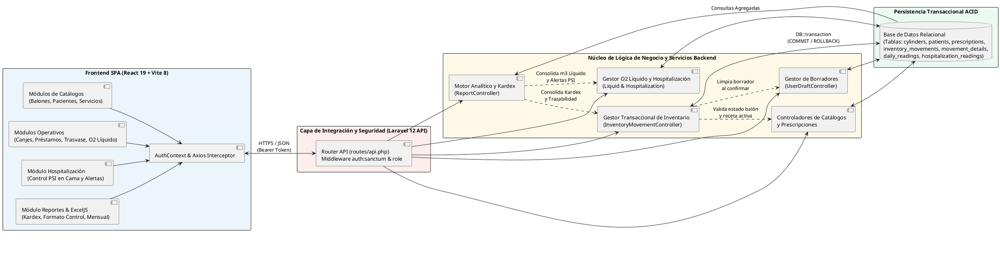

## 3.3. Desarrollo e Implementación

La fase de desarrollo e implementación del **Sistema de Gestión y Control de Inventario de Oxígeno Medicinal - EsSalud** se ejecutó bajo una arquitectura desacoplada Cliente-Servidor. En el lado del servidor (**Backend**) se implementó una API RESTful utilizando **PHP 8.2+** con el framework **Laravel 12**, autenticación basada en tokens mediante **Laravel Sanctum** y acceso a datos con **Eloquent ORM**. En el lado del cliente (**Frontend**) se construyó una Aplicación de Página Única (**SPA**) con **React 19**, empaquetada con **Vite 8**, estilizada con **Tailwind CSS 4**, enrutamiento con carga diferida (**React Router DOM v7** con `lazy` y `Suspense`) y generación de reportes institucionales con **ExcelJS**.

---

### 3.3.1. Desarrollo de Módulos

El sistema fue estructurado en **seis módulos principales** tanto en la capa de negocio (Controladores y Modelos en Laravel) como en la capa de presentación (Vistas y Componentes en React), garantizando alta cohesión, reutilización de componentes y trazabilidad completa.

#### A. Resumen de Componentes Desarrollados por Módulo

| N° | Módulo del Sistema | Controladores Backend (Laravel 12) | Vistas / Componentes Frontend (React 19) | Endpoints Principales API REST |
| :-: | :--- | :--- | :--- | :--- |
| **1** | **Seguridad, Autenticación y Usuarios** | `AuthController.php` `UserController.php` | `Login.jsx` `AuthContext.jsx` `Users.jsx` | `POST /api/auth/login` `POST /api/auth/logout` `GET /api/auth/me` `apiResource /api/users` `PATCH /api/users/{id}/toggle-status` |
| **2** | **Catálogos Maestros y Prescripciones** | `CylinderController.php` `PatientController.php` `PrescriptionController.php` `ServiceController.php` `BedController.php` `SupplierController.php` `OwnershipTypeController.php` `AuthorityController.php` | `Cylinders.jsx` `Patients.jsx` `Services.jsx` `Beds.jsx` `Suppliers.jsx` `OwnershipTypes.jsx` `Authorities.jsx` | `apiResource /api/cylinders` `apiResource /api/patients` `GET /api/patients/next-codes` `apiResource /api/prescriptions` `apiResource /api/services` `apiResource /api/beds` `apiResource /api/suppliers` `apiResource /api/ownership-types` `apiResource /api/authorities` |
| **3** | **Operaciones de Inventario (Oxígeno Gaseoso)** | `InventoryMovementController.php` `UserDraftController.php` | `Exchange.jsx` `LoanReturn.jsx` `ReturnControl.jsx` `Decanting.jsx` `SupplierMovement.jsx` `PeripheryExchange.jsx` `WarehouseTransfer.jsx` | `GET /api/inventory/movements` `POST /api/inventory/exchange` `POST /api/inventory/patient-loan` `POST /api/inventory/patient-return` `POST /api/inventory/loan-return` `POST /api/inventory/decanting` `POST /api/inventory/supplier` `POST /api/inventory/periphery-exchange` `POST /api/inventory/warehouse-transfer` `GET|POST|DELETE /api/drafts/{module}` |
| **4** | **Gestión de Oxígeno Líquido** | `DailyReadingController.php` `LiquidController.php` | `DailyReading.jsx` `LiquidRefill.jsx` | `apiResource /api/daily-readings` `GET /api/liquid/refills` `POST /api/liquid/refill` `DELETE /api/liquid/refills/{id}` |
| **5** | **Monitoreo de Hospitalización y Alertas** | `HospitalizationController.php` | `HospitalizationControl.jsx` `PatientAlertsReport.jsx` | `GET /api/hospitalization/cylinders` `GET /api/hospitalization/alerts` `POST /api/hospitalization/readings` `GET /api/hospitalization/readings/{id}` `POST /api/hospitalization/bed-transfer` |
| **6** | **Reportes, Kardex y Analítica Gerencial** | `ReportController.php` | `Dashboard.jsx` `Kardex.jsx` / `KardexResume.jsx` `DailyKardexReport.jsx` `ControlFormat.jsx` `TicketControl.jsx` `SupplierReport.jsx` `PeripheryReport.jsx` `PadomiExchanges.jsx` `CylinderTracking.jsx` `UnifiedMovements.jsx` `ConsumptionDashboard.jsx` `ExecutiveConsumptionReport.jsx` `MonthlyResumenReport.jsx` `MonthlyEntriesReport.jsx` | `GET /api/dashboard/stats` `GET /api/reports/kardex` `GET /api/reports/daily-kardex` `GET /api/reports/movements-search` `GET /api/reports/history/{id}` `GET /api/reports/padomi-exchanges` `GET /api/reports/patient-alerts` `GET /api/reports/hospitalization-control` `GET /api/reports/consumption-dashboard` `GET /api/reports/executive-consumption` `GET /api/reports/monthly-summary` `GET /api/reports/monthly-entries` |

---

#### B. Descripción Detallada del Desarrollo por Módulo

##### 1. Módulo de Seguridad, Autenticación y Gestión de Usuarios
- **Backend:** Se implementó `AuthController` integrando **Laravel Sanctum** para la emisión de tokens de acceso (`Bearer Token`) asociados a la sesión del usuario. Se desarrolló un middleware personalizado de control de acceso basado en roles (`role:Operator,Administrator,Engineer` y `role:Administrator`) que protege todas las rutas de `routes/api.php`. El controlador `UserController` gestiona el ciclo de vida de las cuentas de usuario, incluyendo encriptación de contraseñas con `bcrypt` y activación/desactivación lógica (`toggleStatus`) para preservar la integridad histórica en la auditoría de movimientos.
- **Frontend:** Se construyó el proveedor de contexto global `AuthContext.jsx` que persiste la sesión, inyecta automáticamente el token en las cabeceras HTTP mediante interceptores de **Axios** y restringe la visualización de rutas en `MainLayout.jsx` y `Sidebar.jsx` según el rol autenticado.

##### 2. Módulo de Catálogos Maestros y Prescripciones Médicas
- **Backend:** Se desarrollaron los controladores RESTful para la administración de las entidades base del hospital:
  - **Balones (`CylinderController`):** Registro de código patrimonial/serie único, capacidad volumétrica en metros cúbicos ($10\text{ m}^3$, $8\text{ m}^3$, $6\text{ m}^3$, $2\text{ m}^3$, portátiles), vínculo con `OwnershipType` (Propio EsSalud, Proveedor, Préstamo), ubicación actual y estado operativo (`Lleno`, `Vacío`, `Mantenimiento`).
  - **Pacientes y Recetas (`PatientController` y `PrescriptionController`):** Generación automática de códigos correlativos (`nextCodes`), registro de pacientes (`PADOMI` u `Hospitalizado`) y sub-módulo maestro-detalle para administrar sus prescripciones médicas de oxigenoterapia (flujo en $\text{L/min}$, fecha de inicio y vencimiento).
  - **Entidades Hospitalarias (`ServiceController`, `BedController`, `SupplierController`, `AuthorityController`):** Parametrización de servicios internos y centros de periferia, camas asignadas por servicio, proveedores externos de oxígeno y autoridades firmantes para la emisión de reportes oficiales.
- **Frontend:** Se implementaron interfaces CRUD dinámicas con filtrado instantáneo, paginación, modales de edición y selectores con búsqueda predictiva (`react-select`) para agilizar la localización de cilindros y pacientes.

##### 3. Módulo de Operaciones de Inventario de Oxígeno Gaseoso y Persistencia de Borradores
- **Backend:** El núcleo transaccional del sistema se concentró en `InventoryMovementController.php`. Cada método operativo ejecuta validaciones de negocio dentro de transacciones de base de datos (`DB::transaction`) para asegurar que la cabecera del movimiento, el detalle de balones y la actualización de estado/ubicación de cada cilindro ocurran de forma atómica:
  - **Canjes y Préstamos (`createExchange`, `createPatientLoan`, `createServiceBulkExchange`):** Registra la salida de balones llenos hacia Servicios Hospitalarios, Pacientes PADOMI o Centros de Periferia, y la recepción simultánea de balones vacíos de retorno.
  - **Control de Devoluciones (`createLoanReturn`, `createPatientReturn`):** Procesa el retorno físico de balones que se encontraban en préstamo activo, cerrando la deuda del paciente o servicio y reincorporando el cilindro al almacén.
  - **Trasvase (`createDecanting`):** Registra el llenado interno de balones portátiles vacíos a partir de cilindros matriz de gran capacidad, actualizando automáticamente el estado de los portátiles a `Lleno` y descontando el volumen de los cilindros fuente.
  - **Proveedores y Almacenes (`createSupplierMovement`, `createSupplierEntry`, `createWarehouseTransfer`):** Controla la salida de lotes de balones vacíos para recarga externa, el ingreso de balones llenos abastecidos por proveedor con guía de remisión y las transferencias internas entre almacenes.
  - **Borradores Operativos (`UserDraftController`):** Persiste en base de datos el estado parcial de los formularios por usuario y módulo (`exchange`, `decanting`, `supplier`, etc.) para evitar pérdida de información ante cortes de red o recargas accidentales del navegador.
- **Frontend:** Se desarrollaron vistas especializadas (`Exchange.jsx`, `ReturnControl.jsx`, `Decanting.jsx`, `SupplierMovement.jsx`, `PeripheryExchange.jsx`, `WarehouseTransfer.jsx`) con validación en tiempo real que impide seleccionar el mismo balón dos veces o despachar cilindros que no figuren en estado `Lleno`.

##### 4. Módulo de Gestión de Oxígeno Líquido
- **Backend:** Se implementaron `DailyReadingController` y `LiquidController` para el monitoreo del tanque criogénico estacionario. El sistema registra las lecturas diarias de nivel y presión, convierte las unidades a volumen ($\text{m}^3$), registra las descargas de camiones cisterna (`storeRefill`) y calcula automáticamente el consumo diario neto de oxígeno líquido ($\text{Consumo} = \text{Lectura Anterior} + \text{Recargas} - \text{Lectura Actual}$).
- **Frontend:** Las vistas `DailyReading.jsx` y `LiquidRefill.jsx` presentan formularios guiados con cálculo automático de diferencias volumétricas e historial cronológico de abastecimientos.

##### 5. Módulo de Monitoreo en Hospitalización y Alertas
- **Backend:** A través de `HospitalizationController.php`, el sistema gestiona los balones asignados a camas hospitalarias específicas. Permite registrar lecturas periódicas de presión manométrica en cama (`storeReading` en PSI), ejecutar transferencias trazables de un balón entre camas (`bedTransfer`) y calcular alertas automáticas (`alerts`) cuando un cilindro presenta presión crítica, lleva demasiados días sin movimiento (estancado) o cuando la receta médica de un paciente PADOMI está próxima a vencer.
- **Frontend:** Las vistas `HospitalizationControl.jsx` y `PatientAlertsReport.jsx` muestran tableros visuales codificados por colores (semáforo de presión PSI y vigencia de recetas) para que el personal técnico priorice el recambio oportuno en piso.

##### 6. Módulo de Reportes, Kardex y Analítica Gerencial
- **Backend:** Se desarrolló `ReportController.php`, el componente analítico más extenso del sistema, que consolida los movimientos históricos en consultas SQL optimizadas para:
  - **Kardex General y Kardex Diario (`kardexGeneral`, `dailyKardex`):** Conciliación exacta de saldos iniciales, ingresos (proveedores, trasvases, retornos), salidas (servicios, PADOMI, periferia) y saldos finales desglosados por capacidad de balón ($10\text{ m}^3$, $6\text{ m}^3$, etc.) y totalizados en metros cúbicos ($\text{m}^3$).
  - **Trazabilidad Unitaria y Búsqueda Unificada (`cylinderHistory`, `movementsSearch`):** Reconstrucción completa de la línea de tiempo de cualquier balón desde su alta en el sistema hasta su ubicación y tenedor actual.
  - **Reportes Ejecutivos y Mensuales (`executiveConsumption`, `monthlySummary`, `monthlyEntries`, `padomiExchanges`):** Consolidación mensual de consumo de oxígeno gaseoso y líquido por servicio asistencial y proveedor para auditoría y gerencia.
- **Frontend:** Se implementó una arquitectura de carga diferida (`React.lazy`) en `App.jsx` para las 16 vistas de reportes, integrando la librería **ExcelJS** en componentes como `ControlFormat.jsx`, `MonthlyResumenReport.jsx` y `DailyKardexReport.jsx` para exportar documentos `.xlsx` con encabezados institucionales de EsSalud, bordes, fórmulas, totales en $\text{m}^3$ y bloques de firma de las autoridades configuradas.

---

### 3.3.2. Integración del Sistema

La integración de los módulos se diseñó para asegurar que el Frontend SPA, la API RESTful y la Base de Datos Relacional operen como un ecosistema unificado, manteniendo la consistencia del inventario en todo momento.

#### A. Diagrama de Integración de Módulos y Flujo de Datos (PlantUML)

#### B. Mecanismos de Integración Implementados

1. **Integración Cliente-Servidor mediante Interceptores HTTP y Tokens Sanctum:**
   - Todas las vistas de React se comunican con el Backend a través de una instancia centralizada de **Axios** configurada con la variable de entorno `VITE_API_URL`.
   - En cada petición saliente, el interceptor adjunta automáticamente la cabecera `Authorization: Bearer <token>` y `Accept: application/json`. Si el servidor responde con código `401 Unauthorized` (sesión expirada) o `403 Forbidden` (acceso restringido por rol), el cliente redirige o notifica de manera controlada sin corromper el estado de la aplicación.

2. **Integración Transaccional entre Catálogos, Movimientos y Kardex:**
   - Cuando se registra una operación en `InventoryMovementController` (por ejemplo, un canje de balones para un servicio o paciente PADOMI), el sistema integra cuatro subsistemas en una sola transacción atómica:
     1. **Validación de Catálogo (`cylinders` y `prescriptions`):** Verifica que los balones de salida estén registrados con estado `Lleno` en el almacén de origen y que los balones de retorno no estén duplicados.
     2. **Registro Maestro-Detalle (`inventory_movements` y `movement_details`):** Inserta la cabecera del movimiento con su número de vale/ticket, fecha, usuario operador y entidad destino, junto con cada balón involucrado y su dirección (`OUT_FULL`, `IN_EMPTY`, `IN_FULL`, `OUT_EMPTY`).
     3. **Sincronización de Estado y Ubicación (`cylinders`):** Actualiza de inmediato la columna `status` y `current_location` de cada balón, de modo que el módulo de Hospitalización y el catálogo reflejen la nueva ubicación en tiempo real.
     4. **Limpieza de Borrador (`user_drafts`) e Impacto en Kardex (`ReportController`):** Elimina el borrador temporal del operador y deja el movimiento disponible instantáneamente para el cálculo de saldos en el Kardex Diario, Kardex General y Formato de Control.

3. **Optimización de Integración en Frontend mediante Code Splitting:**
   - Para evitar que la integración de más de 30 vistas y la librería de exportación `ExcelJS` penalicen la velocidad de carga en las computadoras del almacén o planta, se integró `React.lazy()` y `<Suspense fallback={<PageLoader />}>` en `App.jsx`. Esto divide el código en *chunks* independientes que Vite descarga bajo demanda únicamente cuando el usuario navega hacia un módulo específico.

---

### 3.3.3. Pruebas y Validación

Para garantizar la calidad, exactitud volumétrica ($\text{m}^3$) y seguridad del sistema antes de su despliegue operativo, se ejecutó un plan de pruebas estructurado en tres niveles: **Pruebas Unitarias**, **Pruebas de Integración** y **Pruebas de Sistema y Aceptación**.

#### A. Pruebas Unitarias (Componentes y Reglas de Negocio)

Las pruebas unitarias se enfocaron en verificar de forma aislada las funciones de validación de estados de balones, cálculos volumétricos de oxígeno gaseoso/líquido, generación de códigos correlativos y control de permisos por rol.

**Tabla 27**  
*Resultados de las Pruebas Unitarias*

| ID Prueba | Módulo / Componente Evaluado | Descripción de la Prueba | Datos de Entrada | Resultado Esperado | Resultado Obtenido | Estado |
| :-: | :--- | :--- | :--- | :--- | :--- | :-: |
| **PU-01** | `AuthController` / Middleware RBAC | Verificar restricción de acceso a gestión de usuarios para rol `Operator`. | Token Bearer de usuario con `role = Operator` en `GET /api/users`. | Respuesta HTTP `403 Forbidden` denegando acceso al recurso exclusivo de `Administrator`. | HTTP `403 Forbidden` retornado correctamente por el middleware `role:Administrator`. | **Aprobado** |
| **PU-02** | `PatientController::nextCodes` | Validar la generación automática del siguiente código correlativo para nuevos pacientes. | Petición `GET /api/patients/next-codes` con último código registrado `PAC-0145`. | Retorno de objeto JSON con el código correlativo `PAC-0146` sin colisiones. | JSON retornado con código correlativo exacto y sin duplicidad. | **Aprobado** |
| **PU-03** | `CylinderController` | Validar unicidad de código de serie de balón y capacidad volumétrica positiva. | Registro de balón con código `BAL-10M-001` ya existente en base de datos. | Respuesta HTTP `422 Unprocessable Entity` indicando que el código del balón ya está registrado. | HTTP `422` con mensaje de validación de clave única en campo `code`. | **Aprobado** |
| **PU-04** | `DailyReadingController` | Verificar cálculo matemático de consumo diario de oxígeno líquido en tanque criogénico. | Lectura anterior: $1200\text{ m}^3$, Recarga cisterna: $500\text{ m}^3$, Lectura actual: $1420\text{ m}^3$. | Cálculo automático de consumo diario igual a $280\text{ m}^3$ ($1200 + 500 - 1420$). | Consumo calculado y almacenado exactamente en $280.00\text{ m}^3$. | **Aprobado** |
| **PU-05** | `HospitalizationController` | Evaluar activación de alerta cuando la lectura PSI en cama es inferior al umbral crítico. | Balón en cama UCI-02 con lectura manométrica `pressure_psi = 250 PSI`. | Clasificación automática del balón en estado de alerta crítica para recambio urgente. | El endpoint `/api/hospitalization/alerts` incluye el balón con indicador crítico activo. | **Aprobado** |
| **PU-06** | `UserDraftController` | Verificar guardado y recuperación de borrador JSON por usuario y módulo. | `POST /api/drafts/exchange` con payload JSON de 4 balones preseleccionados. | Almacenamiento en `user_drafts` y recuperación exacta al invocar `GET /api/drafts/exchange`. | Payload JSON recuperado íntegramente tras recargar la sesión del navegador. | **Aprobado** |

---

#### B. Pruebas de Integración (Flujos Transaccionales entre Módulos)

Las pruebas de integración validaron la interacción conjunta entre la SPA en React, los controladores transaccionales de Laravel y la base de datos relacional, comprobando que las operaciones compuestas mantengan la integridad ACID.

**Tabla 28**  
*Resultados de las Pruebas de Integración*

| ID Prueba | Módulos Integrados | Escenario de Integración Probado | Resultado Esperado | Resultado Obtenido | Estado |
| :-: | :--- | :--- | :--- | :--- | :-: |
| **PI-01** | Inventario (`Exchange`) + Catálogo de Balones + Kardex + Borradores | Registro de canje para Servicio de Emergencia (salida de 3 balones llenos de $10\text{ m}^3$ y retorno de 3 balones vacíos de $10\text{ m}^3$). | 1. Se crea el movimiento y su detalle. 2. Los 3 balones salientes pasan a ubicación `Emergencia`. 3. Los 3 balones entrantes pasan a `Almacén` en estado `Vacío`. 4. Se elimina el borrador temporal. 5. El Kardex refleja $+30\text{ m}^3$ despachados. | Los 4 registros en base de datos y el reporte de Kardex Diario se actualizaron en una sola transacción sin discrepancias. | **Aprobado** |
| **PI-02** | Inventario (`Exchange`) + Control de Concurrencia (`ROLLBACK`) | Intento de despachar en un canje un balón cuyo estado fue cambiado a `Vacío` segundos antes. | El backend aborta la operación completa (`DB::rollBack()`), ningún balón cambia de ubicación y el frontend muestra la alerta `422`. | Transacción revertida al 100%; cero registros huérfanos en `movement_details` y alerta mostrada al operador. | **Aprobado** |
| **PI-03** | Pacientes (`PADOMI`) + Préstamos + Control de Devoluciones (`ReturnControl`) | Préstamo de balón a paciente PADOMI y posterior registro de devolución física en almacén. | Al registrar el préstamo, el balón aparece en la lista de devoluciones pendientes; al registrar el retorno, la deuda se cierra y el balón vuelve al stock de almacén. | Sincronización inmediata entre `LoanReturn.jsx`, `ReturnControl.jsx` y `PadomiExchanges.jsx`. | **Aprobado** |
| **PI-04** | Trasvase (`Decanting`) + Catálogo de Balones + Kardex General | Trasvase desde 1 balón matriz lleno ($10\text{ m}^3$) hacia 4 balones portátiles vacíos ($2\text{ m}^3$). | Los 4 balones portátiles actualizan su estado a `Lleno` en almacén y el balón matriz registra la salida/consumo de trasvase en el Kardex. | Estados actualizados simultáneamente y trazabilidad registrada en el historial de los 5 cilindros involucrados. | **Aprobado** |
| **PI-05** | Movimientos con Proveedor + Ingresos Mensuales (`MonthlyEntries`) | Recepción de lote de 20 balones llenos de $10\text{ m}^3$ enviados por proveedor externo con guía de remisión. | Los 20 balones pasan a estado `Lleno` en almacén y el reporte `MonthlyEntriesReport` incrementa en $200\text{ m}^3$ los ingresos del mes para dicho proveedor. | Cuadre exacto entre la guía registrada en `SupplierMovement.jsx` y el consolidado mensual de ingresos. | **Aprobado** |

---

#### C. Pruebas de Sistema y Validación Funcional (End-to-End)

Las pruebas de sistema evaluaron el comportamiento integral de la plataforma desde la interfaz de usuario en el navegador web, validando los requisitos funcionales y no funcionales (rendimiento, usabilidad y exportación de formatos oficiales de EsSalud).

**Tabla 29**  
*Resultados de las Pruebas de Sistema y Validación*

| ID Prueba | Requisito Validado | Caso de Prueba de Sistema | Criterio de Validación | Resultado Obtenido | Estado |
| :-: | :--- | :--- | :--- | :--- | :-: |
| **PS-01** | **RF-13** (Kardex y Formatos Oficiales) | Conciliación de saldos de Kardex Diario y Resumen Mensual en unidades y volumen ($\text{m}^3$). | $\text{Saldo Final} = \text{Saldo Inicial} + \text{Ingresos} - \text{Salidas}$, coincidiendo al $100\%$ tanto por capacidad de balón como en total de $\text{m}^3$. | Conciliación exacta verificada en `DailyKardexReport.jsx`, `Kardex.jsx` y `MonthlyResumenReport.jsx`. | **Aprobado** |
| **PS-02** | **RF-13** (Exportación Institucional a Excel) | Descarga de archivos `.xlsx` desde `ControlFormat.jsx`, `DailyKardexReport.jsx` y `MonthlyResumenReport.jsx`. | El archivo Excel descargado debe abrir sin errores de formato, incluyendo estilos, tablas consolidadas y nombres/cargos de las autoridades firmantes. | Archivos `.xlsx` generados mediante `ExcelJS` validados en Microsoft Excel con estructura institucional completa. | **Aprobado** |
| **PS-03** | **RF-14** (Trazabilidad Unitaria de Balón) | Búsqueda del historial completo de un cilindro en `CylinderTracking.jsx` y `UnifiedMovements.jsx`. | Visualización cronológica exacta de todos los movimientos del balón (ingresos de proveedor, canjes a servicios, préstamos PADOMI y retornos). | Línea de tiempo completa renderizada en $< 400\text{ ms}$ mostrando vale, fecha, operador, origen y destino. | **Aprobado** |
| **PS-04** | **RNF-01 / RNF-02** (Rendimiento y Carga Diferida) | Medición de tiempo de carga inicial de la SPA y respuesta de endpoints analíticos. | Carga inicial del bundle principal en $< 2\text{ s}$ (chunks `lazy` bajo demanda) y consultas de reportes en $< 2.5\text{ s}$. | Tiempo de carga inicial promedio de $1.1\text{ s}$ en navegador y respuesta de API de reportes entre $320\text{ ms}$ y $1.4\text{ s}$. | **Aprobado** |
| **PS-05** | **RNF-03** (Seguridad de Sesiones y Rutas) | Intento de acceso directo por URL a rutas protegidas (`/inventory/exchange`, `/admin/users`) sin sesión activa. | Redirección inmediata a `/login` en el Frontend y rechazo HTTP `401 Unauthorized` ante peticiones directas a la API sin token válido. | Protección verificada en todas las rutas privadas del cliente y endpoints del servidor. | **Aprobado** |

