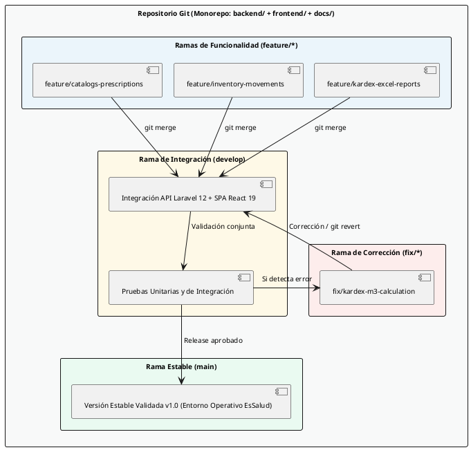

## 3.4. Gestión de la Calidad

La gestión de la calidad en el desarrollo del **Sistema de Gestión y Control de Inventario de Oxígeno Medicinal - EsSalud** tuvo como propósito garantizar que el software cumpla con los estándares técnicos, normativos y operativos exigidos en un entorno hospitalario crítico. Dado que el control de gases medicinales impacta directamente en la continuidad asistencial (Hospitalización, UCI, Emergencia, PADOMI y Centros de Periferia) y en la auditoría patrimonial de cilindros y consumo volumétrico ($\text{m}^3$), se establecieron prácticas preventivas y de control desde la etapa de definición de requisitos hasta la administración del código fuente.

---

### 3.4.1. Estrategias de Aseguramiento de la Calidad

El aseguramiento de la calidad (**SQA - Software Quality Assurance**) se implementó de manera transversal durante todo el ciclo de vida del proyecto, combinando la validación funcional temprana con los usuarios finales de EsSalud y el control estricto de cambios técnicos en el repositorio de código.

---

#### 3.4.1.1. Revisión de Requisitos

La revisión de requisitos se ejecutó de forma iterativa antes y durante la construcción de cada módulo para asegurar que los **14 Requisitos Funcionales (RF-01 a RF-14)** y los **6 Requisitos No Funcionales (RNF-01 a RNF-06)** estuvieran definidos de forma clara, consistente, completa y verificable.

##### A. Criterios de Evaluación de Calidad de Requisitos

Cada requisito documentado fue sometido a una lista de verificación (*checklist*) basada en cinco atributos de calidad:

| Atributo de Calidad | Criterio de Verificación Aplicado en el Proyecto | Ejemplo de Aplicación en el Sistema EsSalud |
| :--- | :--- | :--- |
| **Claridad y No Ambigüedad** | Cada requisito debe tener una única interpretación técnica y operativa, especificando roles, estados y unidades de medida exactas. | Definir explícitamente que los estados operativos de un balón son `Lleno`, `Vacío` y `Mantenimiento`, y que las capacidades y consumos se expresan en metros cúbicos ($\text{m}^3$) y la presión en cama en $\text{PSI}$. |
| **Consistencia** | Ningún requisito debe contradecir a otro ni entrar en conflicto con las reglas del Kardex o del modelo de base de datos. | Asegurar que toda salida de balón `Lleno` en canje o préstamo (**RF-06**) sea consistente con el descuento automático de stock en el Kardex Diario (**RF-13**) y el cambio de ubicación del cilindro (**RF-03**). |
| **Completitud** | El requisito debe contemplar tanto el flujo normal de operación como las excepciones, validaciones y persistencia temporal. | Incluir el guardado automático de borradores (**RF-12 - `UserDrafts`**) y la reversión transaccional (`ROLLBACK`) cuando un operador intenta despachar un balón no disponible. |
| **Verificabilidad** | Todo requisito debe contar con un criterio cuantificable o demostrable que permita diseñar un caso de prueba objetivo. | Establecer métricas concretas en los requisitos no funcionales, como carga inicial $< 2\text{ s}$ (**RNF-01**) y respuesta de endpoints CRUD $< 500\text{ ms}$ (**RNF-02**). |
| **Trazabilidad** | Cada requisito debe vincularse directamente con un Caso de Uso (`CU-01` a `CU-12`), un controlador en el Backend y una prueba de validación. | El requisito **RF-10** (Oxígeno Líquido) se traza con el caso de uso **CU-10**, los controladores `DailyReadingController` / `LiquidController` y la prueba unitaria **PU-04**. |

##### B. Sesiones de Validación con Usuarios y Stakeholders (EsSalud)

Se llevaron a cabo mesas de revisión y validación de prototipos con los actores clave involucrados en la cadena de suministro y control de oxígeno medicinal del hospital:

**Tabla 30**  
*Matriz de Revisión y Validación de Requisitos con Stakeholders*

| Stakeholder / Área Participante | Módulos y Requisitos Revisados | Observaciones y Ajustes Incorporados tras la Revisión | Estado de Validación |
| :--- | :--- | :--- | :-: |
| **Jefatura e Ingeniería Hospitalaria** | Catálogos maestros (**RF-03, RF-05**), Oxígeno Líquido (**RF-10**), Kardex General/Diario (**RF-13**) y Reportes Ejecutivos (**RF-14**). | Se solicitó que los reportes de Kardex, Formato de Control y Resumen Mensual desglosen las columnas por capacidad de cilindro ($10\text{ m}^3$, $8\text{ m}^3$, $6\text{ m}^3$, portátiles), totalicen en $\text{m}^3$ e incluyan dinámicamente los nombres y cargos de las autoridades firmantes en el archivo Excel (`.xlsx`). | **Validado y Aprobado** |
| **Operadores de Planta y Almacén de Oxígeno** | Canjes y Préstamos (**RF-06**), Control de Devoluciones (**RF-07**), Trasvase/Decanting (**RF-08**), Proveedores (**RF-09**) y Borradores (**RF-12**). | Se identificó la necesidad de preservar los datos ingresados en formularios extensos ante interrupciones de turno o red, lo que originó la implementación del módulo de borradores automáticos (`UserDrafts`) y selectores con búsqueda rápida por código de serie. | **Validado y Aprobado** |
| **Personal de Supervisión en Hospitalización y PADOMI** | Pacientes y Prescripciones (**RF-04**), Canjes PADOMI (**RF-06**) y Monitoreo en Cama con Alertas (**RF-11**). | Se incorporó el control de vigencia de recetas médicas (flujo en $\text{L/min}$ y fechas de vencimiento), el registro de transferencias de balones entre camas (`bed-transfer`) y un sistema de alertas por baja presión manométrica ($\text{PSI}$) y balones estancados. | **Validado y Aprobado** |
| **Administrador del Sistema / TI** | Autenticación Sanctum (**RF-01**), Gestión de Usuarios (**RF-02**) y Requisitos No Funcionales (**RNF-01 a RNF-06**). | Se estableció que las cuentas de usuario no deben eliminarse físicamente sino desactivarse (`toggle-status`) para no perder la auditoría histórica de quién registró cada movimiento de inventario. | **Validado y Aprobado** |

---

#### 3.4.1.2. Control de Versiones

Para administrar la evolución del código fuente, coordinar el desarrollo simultáneo entre el **Backend (Laravel 12)** y el **Frontend (React 19)**, y garantizar la capacidad de recuperación ante fallos, se utilizó **Git** como sistema de control de versiones distribuido bajo una estructura de repositorio unificado (*Monorepo* con directorios `backend/`, `frontend/` y `docs/`).

##### A. Estructura del Repositorio y Estrategia de Ramificación (Branching)

El flujo de trabajo en Git se organizó separando el código estable de producción de las ramas de desarrollo e integración de nuevas funcionalidades:

1. **Rama Principal (`main`):** Contiene únicamente versiones estables, probadas y listas para despliegue en el entorno operativo del hospital.
2. **Rama de Integración (`develop`):** Rama donde convergen las actualizaciones de los módulos de Backend y Frontend para ejecutar las pruebas de integración antes de pasar a producción.
3. **Ramas de Funcionalidad (`feature/<nombre-modulo>`):** Ramas creadas para desarrollar módulos o mejoras específicas sin afectar la estabilidad del sistema (ej. `feature/inventory-decanting`, `feature/liquid-readings`, `feature/excel-monthly-reports`, `feature/hospitalization-psi`).
4. **Ramas de Corrección (`fix/<descripcion>` / `hotfix/<descripcion>`):** Utilizadas para aislar y corregir incidencias detectadas durante las pruebas de cuadre de Kardex o validación de formularios, permitiendo aplicar ajustes puntuales y verificados.

##### B. Diagrama del Flujo de Control de Versiones con Git (PlantUML)

##### C. Prácticas de Control de Cambios, Trazabilidad y Reversión de Errores

Para asegurar la mantenibilidad del código y la recuperación inmediata ante cualquier regresión, se aplicaron las siguientes prácticas técnicas:

**Tabla 31**  
*Prácticas de Gestión de Código Fuente y Control de Versiones Implementadas*

| Práctica de Control | Implementación Técnica en el Proyecto | Beneficio para la Calidad del Sistema |
| :--- | :--- | :--- |
| **Convención de Commits Semánticos** | Uso de prefijos descriptivos en cada registro de cambio: `feat:` (nueva funcionalidad), `fix:` (corrección de error), `refactor:` (mejora de código en controladores o vistas), `docs:` (documentación técnica). | Permite identificar rápidamente en el historial (`git log`) qué módulo fue modificado y por qué motivo. |
| **Versionado de Esquema de Base de Datos (Migraciones)** | Todos los cambios en tablas (`cylinders`, `inventory_movements`, `prescriptions`, `daily_readings`, `user_drafts`) se registraron mediante archivos de migración de Laravel (`database/migrations/*.php`) con métodos `up()` y `down()`. | Garantiza que la estructura de la base de datos esté sincronizada con la versión del código fuente y permite revertir cambios de esquema con `php artisan migrate:rollback`. |
| **Exclusión de Archivos Sensibles y Dependencias (`.gitignore`)** | Configuración estricta de `.gitignore` en `backend/` y `frontend/` para excluir archivos de entorno con credenciales (`.env`), carpetas de paquetes (`vendor/`, `node_modules/`) y compilados temporales (`dist/`). | Previene la filtración de credenciales de base de datos o claves de aplicación (`APP_KEY`) y mantiene el repositorio limpio y portable. |
| **Reversión Segura ante Errores (`git revert` / `git checkout`)** | Ante cualquier cambio que introduzca una discrepancia en las fórmulas del Kardex o en un componente de React, Git permite comparar diferencias exactas (`git diff`) y deshacer el commit defectuoso mediante `git revert <commit-hash>` sin destruir el historial. | Minimiza el tiempo de recuperación ante fallos y asegura que el sistema pueda volver en segundos a un estado operativo previamente validado. |

